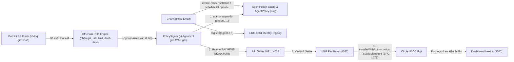

# AgentLeash

Ví cho AI agent có **"dây xích" on-chain**, dự thi **Team1 Vietnam UniHack 2026** trên Avalanche (Track *AI Agents & Security / Agent Economy on x402*).

**Một câu:** AI agent tự thanh toán API qua chuẩn HTTP **x402**, nhưng USDC nằm trong `AgentPolicy` contract của chủ sở hữu; agent chỉ được xin duyệt chi (`authorize`), smart contract mới là chốt chặn cuối theo hạn mức 2 tầng, whitelist và Kill Switch.

> **Khai báo mô phỏng (Luật 6):** Bản demo rút ngắn chu kỳ hạn mức xuống **120 giây** (`DEMO_PERIOD_SECONDS=120`) thay cho 1 ngày thật, và hai API Thời tiết / Tỷ giá trả dữ liệu mock; toàn bộ giao dịch `authorize`, chữ ký **ERC-1271**, chuyển khoản **EIP-3009** USDC, **ERC-8004** và quản trị policy đều chạy thật trên **Avalanche Fuji**.

---

## Kiến trúc & Luồng bảo vệ 2 tầng



- **LLM không giữ khóa (Luật 4):** `agent/src/llm.ts` chỉ trả về `{ tool, args }`, không import `viem`, không tiếp cận `PRIVATE_KEY`.
- **Non-custodial (Luật 3):** Mỗi chủ một `AgentPolicy` riêng; chỉ `owner` mới có quyền `withdraw()`, `pause()`, `setCaps()`, `setWhitelist()`.
- **Không lưu PII lên chuỗi (Luật 5):** On-chain chỉ có địa chỉ ví, số tiền và mã trạng thái.

---

## Địa chỉ triển khai trên Avalanche Fuji (Chain ID `43113`)

| Thành phần | Địa chỉ On-Chain | Trạng thái |
|---|---|---|
| **AgentPolicyFactory** | [`0x369251fC256D8Ae3B25F66Fe1c4b3114A06BA864`](https://testnet.snowscan.xyz/address/0x369251fc256d8ae3b25f66fe1c4b3114a06ba864) | ✅ Verified trên Snowscan |
| **AgentPolicy Demo (chu kỳ 120s)** | [`0x62Ea5e422b3ef66174B6Dd6Aa855F1f036894177`](https://testnet.snowscan.xyz/address/0x62ea5e422b3ef66174b6dd6aa855f1f036894177) | Tạo từ web qua Factory, chủ là ví Privy `0x80a8…d58A` |
| **USDC Testnet (`FiatTokenV2_2`)** | [`0x5425890298aed601595a70AB815c96711a31Bc65`](https://testnet.snowscan.xyz/address/0x5425890298aed601595a70AB815c96711a31Bc65) | Circle Official (hỗ trợ ERC-1271 & EIP-3009) |
| **ERC-8004 Identity Registry** | [`0x8004A818BFB912233c491871b3d84c89A494BD9e`](https://testnet.snowscan.xyz/address/0x8004a818bfb912233c491871b3d84c89a494bd9e) | `AgentIdentity` (`AGENT`) |
| **Ví Agent mẫu** | `0x0F8de357042E53bF0E647066F0Bb1a446133ef9D` | Chỉ giữ ít AVAX gas, không giữ USDC |
| **Facilitator x402** | `http://localhost:4022` (mặc định tự host)<br>`https://facilitator.payai.network` (dự phòng) | Tương thích `eip155:43113` |

---

## Chạy nhanh trong 3 lệnh

Yêu cầu: **Node.js ≥ 22** và bản sao `.env` từ `.env.example` (chỉ dùng ví test Fuji).

```bash
# 1. Cài dependencies cho web, sellers và agent
npm --prefix web install && npm --prefix sellers install && npm --prefix agent install

# 2. Chạy Dashboard (3000) + 2 API Sellers (4021, 4023) ở các terminal (cùng facilitator 4022)
npm --prefix sellers run start:weather & npm --prefix sellers run start:rates & npm --prefix web run dev

# 3. Kiểm tra nhanh trạng thái Fuji và chạy kịch bản demo (hoặc bấm trực tiếp trên Dashboard)
node --env-file=.env scripts/seed-demo.mjs && npm --prefix agent run demo:mock
```

*(Kịch bản giả lập agent bị chiếm qua mặt Rule Engine: `npm --prefix agent run demo:bypass` hoặc bật công tắc **Bỏ qua Rule Engine** ngay ở ô `[4] Bị từ chối` trên Dashboard tại `http://localhost:3000`).*

---

## Cấu trúc dự án

| Thư mục / Tệp | Nội dung chính |
|---|---|
| `contracts/` | `AgentPolicy.sol`, `AgentPolicyFactory.sol` (Foundry: ERC-1271, EIP-3009, 2 tầng hạn mức, Kill Switch, `release(nonce)`). |
| `agent/` | CLI agent (`gemini-3.8-flash` & `--mock-llm`), off-chain `RuleEngine`, `PolicySigner`, nhật ký `audit.json`. |
| `sellers/` | 2 API thu phí x402 (`4021` Thời tiết, `4023` Tỷ giá) giá `0.001 USDC/lượt`. |
| `web/` | Dashboard Next.js 15 + Privy + viem thuần: 4 ô (Tổng quan, Sơ đồ SVG Dòng tiền, Whitelist + `setCaps` + Factory + ERC-8004, Công tắc `--bypass-rules` + Bị từ chối). |
| `scripts/` | `seed-demo.mjs` kiểm tra on-chain policy, số dư, dịch vụ local và hỗ trợ khôi phục trạng thái demo. |
| `docs/` | `SPEC.md`, `ROADMAP.md`, `KE_HOACH_VE_DICH.md`, `SLIDES.md`, `SPIKE.md`, `sessions/`. |

---

## Kiểm thử tự động

```bash
# Smart contracts: Unit, Invariant fuzz (128k calls) và Fuji Fork test
cd contracts && forge test -vvv

# Web Dashboard (Vitest, TypeScript, ESLint)
cd web && npm test && npx tsc --noEmit && npm run lint

# Agent & Rule Engine (Vitest, TypeScript)
cd agent && npm test && npm run typecheck
```

---

## Đội ngũ

- **Nguyên** (CNTT): Kiến trúc hệ thống, smart contract, agent, facilitator & web dashboard.
- **Giang** (Quản lý công nghiệp): Kịch bản demo, thiết kế sản phẩm, slide & thuyết trình.
