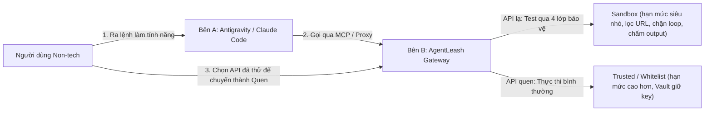
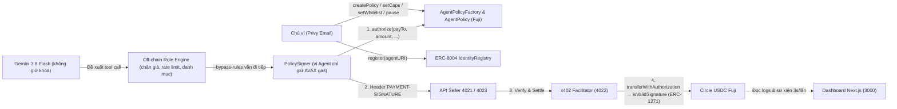

# AgentLeash

Ví cho AI agent có **"dây xích" on-chain** và **cổng kiểm thử & bảo vệ API** cho người dùng dùng công cụ lập trình tự động, dự thi **Team1 Vietnam UniHack 2026** trên Avalanche (Track *AI Agents & Security / Agent Economy on x402*).

**Một câu:** AI agent tự thanh toán API qua chuẩn HTTP **x402**, nhưng USDC nằm trong `AgentPolicy` contract của chủ sở hữu; agent chỉ được xin duyệt chi (`authorize`), smart contract mới là chốt chặn cuối theo hạn mức 2 tầng (Trusted / Sandbox), whitelist và Kill Switch — làm nền tảng phát triển thành cổng bảo vệ giúp người dùng không rành kỹ thuật (non-tech) cho phép AI coding agent tự test API lạ an toàn rồi duyệt thành API quen.

> **Khai báo mô phỏng (Luật 6):** Bản demo rút ngắn chu kỳ hạn mức xuống **120 giây** (`DEMO_PERIOD_SECONDS=120`) thay cho 1 ngày thật, và hai API Thời tiết / Tỷ giá trả dữ liệu mock. Lượt chạy agent trong video dùng LLM giả lập (`--mock-llm`) theo kịch bản cố định; thanh toán x402, `AgentPolicy`, ERC-1271/EIP-3009 và quản trị policy vẫn chạy thật trên **Avalanche Fuji**. Tích hợp Gemini thật có sẵn qua `npm --prefix agent run demo:gd2`.

---

## Tầm nhìn & Hướng phát triển: Cổng bảo vệ API cho người dùng Non-Tech (Bên A – Bên B)

Người dùng không rành code (non-tech / vibe coders) khi dùng các công cụ lập trình tự động (**Bên A**: Antigravity, Claude Code, ...) thường gặp 4 nỗi sợ lớn khi AI tự kết nối API ngoài: **lộ API Key / cháy tiền thẻ tín dụng**, **gọi nhầm API giả mạo/độc hại**, **AI bị kẹt vòng lặp đốt hết ngân sách**, và **không biết dữ liệu API trả về có đúng ý mình hay không**.

**AgentLeash (Bên B)** tích hợp trực tiếp vào **Bên A** (dưới dạng MCP Gateway / Proxy) để giải quyết bài toán này qua cơ chế **"Thử API lạ an toàn → Duyệt thành API quen"**:



1. **Tự động test API lạ (4 lớp bảo vệ):**
   - **Trần ngân sách Sandbox siêu nhỏ:** Cho phép Bên A gọi thử API có phí trong hạn mức an toàn tuyệt đối.
   - **Kiểm tra an toàn & uy tín:** Lọc URL giả mạo, domain độc hại, chống rò rỉ dữ liệu hoặc tấn công SSRF.
   - **Chặn vòng lặp & Rate limit:** Tự động ngắt khi Bên A gọi lặp bất thường, thông báo nguyên nhân bằng tiếng Việt dễ hiểu.
   - **Đánh giá chất lượng đầu ra:** Kiểm tra dữ liệu API trả về có hợp lệ và đáp ứng đúng mục tiêu ban đầu của người dùng không.
2. **Sử dụng API quen & chuyển đổi 1-click:** Người dùng xem danh sách các API mà Bên A đã thử truy cập ngay trên Dashboard và bấm chọn chuyển thành **API quen (Whitelist)** để dùng lâu dài.
3. **Kết hợp cả API truyền thống & API x402:** Hỗ trợ đồng thời **API chuẩn x402** (thanh toán vi mô minh bạch bằng `AgentPolicy` trên Avalanche) và định hướng mở rộng sang **API truyền thống** (dùng API Key/thẻ qua két bảo mật Vault & Quota Proxy, không đưa key thật cho Bên A).

> **Ranh giới bản nộp UniHack (21/11/2026):** Toàn bộ kiến trúc ví chính sách 2 tầng (`AgentPolicy`), Rule Engine, 2 API x402, CLI agent và Dashboard quản trị đang chạy thật trên Avalanche Fuji. Phần tích hợp sâu cho non-tech (MCP Gateway đa nền tảng, Proxy giữ API Key truyền thống và trải nghiệm ẩn hoàn toàn thao tác crypto) là **hướng phát triển tiếp theo** từ nền tảng Sandbox/Whitelist hiện có.

---

## Kiến trúc & Luồng bảo vệ 2 tầng



- **LLM không giữ khóa (Luật 4):** `agent/src/llm.ts` chỉ trả về `{ tool, args }`, không import `viem`, không tiếp cận `PRIVATE_KEY`.
- **Non-custodial (Luật 3):** Mỗi chủ một `AgentPolicy` riêng; chỉ `owner` mới có quyền `withdraw()`, `pause()`, `setCaps()`, `setWhitelist()`.
- **Không lưu PII lên chuỗi (Luật 5):** On-chain chỉ có địa chỉ ví, số tiền và mã trạng thái.

---

## Địa chỉ triển khai trên Avalanche Fuji (Chain ID `43113`)

| Thành phần | Địa chỉ On-Chain | Trạng thái |
|---|---|---|
| **AgentPolicyFactory** | [`0x369251fC256D8Ae3B25F66Fe1c4b3114A06BA864`](https://testnet.snowscan.xyz/address/0x369251fc256d8ae3b25f66fe1c4b3114a06ba864) | ✅ Verified trên Snowscan |
| **AgentPolicy Demo (chu kỳ 120s)** | [`0x62Ea5e422b3ef66174B6Dd6Aa855F1f036894177`](https://testnet.snowscan.xyz/address/0x62ea5e422b3ef66174b6dd6aa855f1f036894177) | Tạo từ web qua Factory, chủ là ví Privy `0x80a8…d58A` |
| **USDC Testnet (`FiatTokenV2_2`)** | [`0x5425890298aed601595a70AB815c96711a31Bc65`](https://testnet.snowscan.xyz/address/0x5425890298aed601595a70AB815c96711a31Bc65) | Circle Official (hỗ trợ ERC-1271 & EIP-3009) |
| **ERC-8004 Identity Registry** | [`0x8004A818BFB912233c491871b3d84c89A494BD9e`](https://testnet.snowscan.xyz/address/0x8004a818bfb912233c491871b3d84c89a494bd9e) | `AgentIdentity` (`AGENT`) |
| **Ví Agent mẫu** | `0x0F8de357042E53bF0E647066F0Bb1a446133ef9D` | Chỉ giữ ít AVAX gas, không giữ USDC |
| **Facilitator x402** | `http://localhost:4022` (mặc định tự host)<br>`https://facilitator.payai.network` (dự phòng) | Tương thích `eip155:43113` |

---

## Chạy nhanh trong 3 lệnh

Yêu cầu: **Node.js ≥ 22** và bản sao `.env` từ `.env.example` (chỉ dùng ví test Fuji).

```bash
# 1. Cài dependencies cho web, sellers và agent
npm --prefix web install && npm --prefix sellers install && npm --prefix agent install

# 2. Chạy Facilitator x402 (4022) + 2 API Sellers (4021, 4023) + Dashboard (3000) ở các terminal
# Lưu ý: starter kit x402-pay-per-request dùng chung biến FACILITATOR_PRIVATE_KEY từ agentleash/.env:
(cd ../x402-pay-per-request && node --env-file=../agentleash/.env src/facilitator.mjs) &
npm --prefix sellers run start:weather & npm --prefix sellers run start:rates & npm --prefix web run dev

# 3. Kiểm tra nhanh trạng thái Fuji và chạy kịch bản demo (hoặc bấm trực tiếp trên Dashboard)
node --env-file=.env scripts/seed-demo.mjs && npm --prefix agent run demo:mock
```

*(Kịch bản giả lập agent bị chiếm qua mặt Rule Engine: `npm --prefix agent run demo:bypass` hoặc bật công tắc **Bỏ qua Rule Engine** ngay ở ô `[4] Bị từ chối` trên Dashboard tại `http://localhost:3000`. Quay video: `npm --prefix web run build && npm --prefix web run start` để chạy bản production sạch cảnh báo dev.)*

---

## Cấu trúc dự án

| Thư mục / Tệp | Nội dung chính |
|---|---|
| `contracts/` | `AgentPolicy.sol`, `AgentPolicyFactory.sol` (Foundry: ERC-1271, EIP-3009, 2 tầng hạn mức, Kill Switch, `release(nonce)`). |
| `agent/` | CLI agent (`gemini-3.8-flash` & `--mock-llm`), MCP Gateway (`src/mcp.ts`), off-chain `RuleEngine`, `PolicySigner`, nhật ký `audit.json`. |
| `sellers/` | 2 API thu phí x402 (`4021` Thời tiết, `4023` Tỷ giá) giá `0.001 USDC/lượt`. |
| `web/` | Dashboard Next.js 15 + Privy + viem thuần: 4 ô (Tổng quan, Sơ đồ SVG Dòng tiền, Whitelist + `setCaps` + Factory + ERC-8004 + nút 1-click **Chuyển thành API quen**, Công tắc `--bypass-rules` + Bị từ chối). |
| `scripts/` | `seed-demo.mjs` kiểm tra on-chain policy, số dư, dịch vụ local và hỗ trợ khôi phục trạng thái demo. |
| `docs/` | `SPEC.md`, `ROADMAP.md`, `KE_HOACH_VE_DICH.md`, `SLIDES.md`, `SPIKE.md`, `sessions/`. |

---

## Thử nghiệm MCP Server cho Bên A (Claude Code / Antigravity)

`agent/src/mcp.ts` bọc `RuleEngine`, `PolicySigner`, x402 client và ghi `agent/logs/audit.json` qua giao thức **MCP stdio**, cung cấp 3 tool:
- `test_unknown_api`: Thử nghiệm API lạ (URL hoặc `payTo`) qua lớp bảo vệ Sandbox + RuleEngine + `AgentPolicy`; trả dữ liệu nếu lọt ngưỡng Sandbox hoặc lý do bị chặn tiếng Việt (ví dụ `ExceedsSandboxPerTxCap`, `PausedError`) và ghi log cho Dashboard.
- `call_trusted_api`: Gọi API trong danh mục Trusted (`weather`, `rates`) hoặc API vừa được chủ ví bấm **Chuyển thành API quen** (`setWhitelist`) trên Dashboard.
- `get_policy_status`: Xem nhanh số dư USDC, hạn mức Trusted/Sandbox còn lại và trạng thái Kill Switch.

Chạy thử trực tiếp:

```bash
npm --prefix agent run mcp
```

Cấu hình vào `.mcp.json` (Claude Code) hoặc cấu hình MCP của Antigravity (thay `<PATH_TO_AGENTLEASH>` bằng đường dẫn tuyệt đối tới thư mục `agentleash`):

```json
{
  "mcpServers": {
    "agentleash": {
      "command": "node",
      "args": ["--env-file=../.env", "src/mcp.ts"],
      "cwd": "<PATH_TO_AGENTLEASH>/agent"
    }
  }
}
```

---

## Kiểm thử tự động

```bash
# Smart contracts: Unit, Invariant fuzz (128k calls) và Fuji Fork test
cd contracts && forge test -vvv

# Web Dashboard (Vitest, TypeScript, ESLint)
cd web && npm test && npx tsc --noEmit && npm run lint

# Agent & Rule Engine (Vitest, TypeScript)
cd agent && npm test && npm run typecheck
```

---

## Đội ngũ

- **Nguyên** (CNTT): Kiến trúc hệ thống, smart contract, agent, facilitator & web dashboard.
- **Giang** (Quản lý công nghiệp): Kịch bản demo, thiết kế sản phẩm, slide & thuyết trình.
