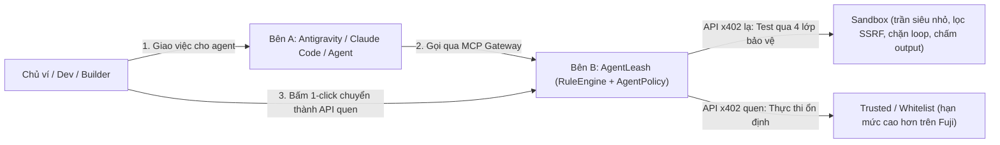
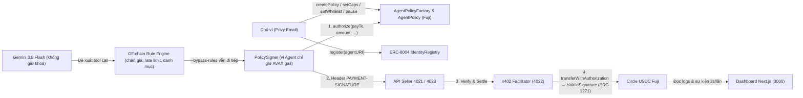

# AgentLeash

Ví cho AI agent có **"dây xích" on-chain** và **cổng kiểm thử & bảo vệ chi tiêu x402 (MCP Gateway)**, dự thi **Team1 Vietnam UniHack 2026** trên Avalanche (Track *AI Agents & Security / Agent Economy on x402*).

**Một câu:** AI agent tự thanh toán API qua chuẩn HTTP **x402**, nhưng USDC nằm trong `AgentPolicy` contract của chủ sở hữu; agent chỉ được xin duyệt chi (`authorize`), smart contract mới là chốt chặn cuối theo hạn mức 2 tầng (Trusted / Sandbox), whitelist và Kill Switch — bảo vệ dev, AI agent builders và người dùng khi agent gọi các API x402 mới qua CLI hoặc MCP.

> **Khai báo mô phỏng (Luật 6):** Bản demo rút ngắn chu kỳ hạn mức xuống **120 giây** (`DEMO_PERIOD_SECONDS=120`) thay cho 1 ngày thật, và ba API Thời tiết / Tỷ giá / Tin tức trả dữ liệu mock. Cảnh agent bị chiếm mã trong video là kịch bản giả lập (`--bypass-rules`, gửi tiền tới địa chỉ lạ `0x1111…`). Bên A trong video là Claude Code thật gọi MCP AgentLeash; thanh toán x402, `AgentPolicy`, ERC-1271/EIP-3009 và quản trị policy chạy thật trên **Avalanche Fuji**. CLI agent có thêm chế độ LLM giả lập (`--mock-llm`) để chạy thử không cần key, và tích hợp Gemini thật qua `npm --prefix agent run demo:gd2`.

---

## Tầm nhìn & Hướng phát triển: Cổng bảo vệ chi tiêu x402 cho AI Agents (Bên A – Bên B)

Khi dùng các công cụ lập trình hoặc AI agent (**Bên A**: Antigravity, Claude Code, agent tự động...) kết nối với các dịch vụ thu phí theo lượt gọi chuẩn HTTP **x402**, chủ ví thường gặp 4 rủi ro lớn: **agent gọi nhầm endpoint lừa đảo/độc hại rút sạch ví**, **bị kẹt vòng lặp (loop bug) đốt hết ngân sách**, **prompt injection đổi địa chỉ nhận tiền (`payTo`)**, và **không kiểm soát được chất lượng dữ liệu trả về**.

**AgentLeash (Bên B)** tích hợp trực tiếp vào **Bên A** qua **MCP Gateway** để giải quyết bài toán này theo cơ chế **"Thử API x402 lạ an toàn → Duyệt thành API quen"**:



1. **Tự động test API x402 lạ (4 lớp bảo vệ):**
   - **Trần ngân sách Sandbox siêu nhỏ:** Cho phép Bên A thử gọi API x402 lạ trong hạn mức an toàn tuyệt đối trên `AgentPolicy`.
   - **Kiểm tra an toàn & chống giả mạo:** Lọc URL độc hại, kiểm tra khớp `payTo`/giá và chặn SSRF.
   - **Chặn vòng lặp & Rate limit:** Tự động ngắt khi Bên A gọi lặp bất thường, thông báo nguyên nhân bằng tiếng Việt rõ ràng.
   - **Đánh giá chất lượng đầu ra (hướng mở rộng):** Kiểm tra dữ liệu API trả về có hợp lệ trước khi Bên A sử dụng tiếp.
2. **Sử dụng API quen & chuyển đổi 1-click:** Chủ ví xem danh sách các giao dịch/từ chối mà Bên A đã thử ngay trên Dashboard và bấm chọn **Chuyển thành API quen** (`setWhitelist`) để cấp hạn mức Trusted.
3. **Định vị tập trung thuần x402:** Giai đoạn đầu tập trung 100% vào thanh toán chuẩn **x402** (USDC trên Avalanche) cho dev / AI agent builders để kiến trúc gọn, đồng nhất và bảo mật on-chain tuyệt đối; dài hạn có thể cân nhắc bổ sung lớp mở rộng hỗ trợ API truyền thống nếu phục vụ thêm người dùng non-tech phổ thông.

> **Ranh giới bản nộp UniHack (21/11/2026):** Toàn bộ kiến trúc ví chính sách 2 tầng (`AgentPolicy`), Rule Engine, 2 API x402, CLI agent, Dashboard quản trị chạy local (cùng ô **Thêm API quen bằng địa chỉ**) và bản MCP local (`agent/src/mcp.ts` trả kèm `DASHBOARD_URL`, kèm lệnh `npm --prefix agent run setup:mcp` tự cấu hình cho Claude Code & Antigravity) nằm trong phạm vi nộp. Phần **phức tạp** để nâng cấp lên **Remote MCP đa người dùng** (Cloud `Streamable HTTP` + OAuth Privy + Session Key từng user + DB đa người dùng với Dashboard cloud + Plugin Marketplace, cùng `POST`/body, siết SSRF IP nội bộ production và sổ `URL ↔ payTo` + chấm output) là **hướng phát triển tiếp theo sau 21/11** (chi tiết tại [docs/SPEC.md](docs/SPEC.md#L223)).

---

## Kiến trúc & Luồng bảo vệ 2 tầng



- **LLM không giữ khóa (Luật 4):** `agent/src/llm.ts` chỉ trả về `{ tool, args }`, không import `viem`, không tiếp cận `PRIVATE_KEY`.
- **Non-custodial (Luật 3):** Mỗi chủ một `AgentPolicy` riêng; chỉ `owner` mới có quyền `withdraw()`, `pause()`, `setCaps()`, `setWhitelist()`.
- **Không lưu PII lên chuỗi (Luật 5):** On-chain chỉ có địa chỉ ví, số tiền và mã trạng thái.

---

## Địa chỉ triển khai trên Avalanche Fuji (Chain ID `43113`)

| Thành phần | Địa chỉ On-Chain | Trạng thái |
|---|---|---|
| **AgentPolicyFactory** | [`0x369251fC256D8Ae3B25F66Fe1c4b3114A06BA864`](https://testnet.snowtrace.io/address/0x369251fc256d8ae3b25f66fe1c4b3114a06ba864) | ✅ Verified trên Snowtrace |
| **AgentPolicy Demo (chu kỳ 120s)** | [`0x62Ea5e422b3ef66174B6Dd6Aa855F1f036894177`](https://testnet.snowtrace.io/address/0x62ea5e422b3ef66174b6dd6aa855f1f036894177) | Tạo từ web qua Factory, chủ là ví Privy `0x80a8…d58A` |
| **USDC Testnet (`FiatTokenV2_2`)** | [`0x5425890298aed601595a70AB815c96711a31Bc65`](https://testnet.snowtrace.io/address/0x5425890298aed601595a70AB815c96711a31Bc65) | Circle Official (hỗ trợ ERC-1271 & EIP-3009) |
| **ERC-8004 Identity Registry** | [`0x8004A818BFB912233c491871b3d84c89A494BD9e`](https://testnet.snowtrace.io/address/0x8004a818bfb912233c491871b3d84c89a494bd9e) | `AgentIdentity` (`AGENT`) |
| **Ví Agent mẫu** | `0x0F8de357042E53bF0E647066F0Bb1a446133ef9D` | Chỉ giữ ít AVAX gas, không giữ USDC |
| **Facilitator x402** | `http://localhost:4022` (mặc định tự host)<br>`https://facilitator.payai.network` (dự phòng) | Tương thích `eip155:43113` |

---

## Chạy nhanh trong 3 lệnh

Yêu cầu: **Node.js ≥ 22** và bản sao `.env` từ `.env.example` (chỉ dùng ví test Fuji).

```bash
# 1. Cài dependencies cho web, sellers và agent
npm --prefix web install && npm --prefix sellers install && npm --prefix agent install

# 2. Chạy Facilitator x402 (4022) + 2 API Sellers (4021, 4023) + Dashboard (3000) ở các terminal
# Lưu ý: starter kit x402-pay-per-request dùng chung biến FACILITATOR_PRIVATE_KEY từ agentleash/.env:
(cd ../x402-pay-per-request && node --env-file=../agentleash/.env src/facilitator.mjs) &
npm --prefix sellers run start:weather & npm --prefix sellers run start:rates & npm --prefix web run dev

# 3. Kiểm tra nhanh trạng thái Fuji và chạy kịch bản demo (hoặc bấm trực tiếp trên Dashboard)
node --env-file=.env scripts/seed-demo.mjs && npm --prefix agent run demo:mock
```

*(Kịch bản giả lập agent bị chiếm qua mặt Rule Engine: `npm --prefix agent run demo:bypass` hoặc bật công tắc **Bỏ qua Rule Engine** ngay ở ô `[4] Bị từ chối` trên Dashboard tại `http://localhost:3000`. Quay video: `npm --prefix web run build && npm --prefix web run start` để chạy bản production sạch cảnh báo dev.)*

---

## Cấu trúc dự án

| Thư mục / Tệp | Nội dung chính |
|---|---|
| `contracts/` | `AgentPolicy.sol`, `AgentPolicyFactory.sol` (Foundry: ERC-1271, EIP-3009, 2 tầng hạn mức, Kill Switch, `release(nonce)`). |
| `agent/` | CLI agent (`gemini-3.8-flash` & `--mock-llm`), MCP Gateway (`src/mcp.ts`), off-chain `RuleEngine`, `PolicySigner`, nhật ký `audit.json`. |
| `sellers/` | 2 API thu phí x402 (`4021` Thời tiết, `4023` Tỷ giá) giá `0.001 USDC/lượt`. |
| `web/` | Dashboard Next.js 15 + Privy + viem thuần, 5 trang: Tổng quan (hạn mức 2 tầng, thanh Demo 2 phút, Kill Switch), Dòng tiền x402, Policy & Luật 2 tầng (Whitelist, `setCaps`, Factory, ERC-8004, nút 1-click **Chuyển thành API quen**), Nhật ký & Rules (Bị từ chối off/on-chain), MCP Bên A – Bên B. |
| `scripts/` | `seed-demo.mjs` kiểm tra on-chain policy, số dư, dịch vụ local và hỗ trợ khôi phục trạng thái demo. |
| `docs/` | `SPEC.md`, `ROADMAP.md`, `KE_HOACH_VE_DICH.md`, `SLIDES.md`, `SPIKE.md`, `sessions/`. |

---

## Thử nghiệm MCP Server cho Bên A (Claude Code / Antigravity)

`agent/src/mcp.ts` bọc `RuleEngine`, `PolicySigner`, x402 client và ghi `agent/logs/audit.json` qua giao thức **MCP stdio**, cung cấp 3 tool:
- `test_unknown_api`: Thử nghiệm API lạ (URL hoặc `payTo`) qua lớp bảo vệ Sandbox + RuleEngine + `AgentPolicy`; trả dữ liệu nếu lọt ngưỡng Sandbox hoặc lý do bị chặn tiếng Việt (ví dụ `ExceedsSandboxPerTxCap`, `PausedError`) và ghi log cho Dashboard.
- `call_trusted_api`: Gọi API trong danh mục Trusted (`weather`, `rates`) hoặc API vừa được chủ ví bấm **Chuyển thành API quen** (`setWhitelist`) trên Dashboard.
- `get_policy_status`: Xem nhanh số dư USDC, hạn mức Trusted/Sandbox còn lại và trạng thái Kill Switch.

> **Phân quyền (Luật 3 & 4):** MCP tuyệt đối không giữ khóa `owner`. Khi gặp `NOT_WHITELISTED`, vượt hạn mức hoặc `PausedError`, trường `hint` sẽ trả kèm sẵn đường link `DASHBOARD_URL` (mặc định `http://localhost:3000`) để chủ ví mở ra ký bằng Privy, kể cả dán địa chỉ `payTo` lấy từ gợi ý MCP vào ô **Thêm API quen bằng địa chỉ** ở trang Policy & Luật 2 tầng.

Chạy thử trực tiếp:

```bash
npm --prefix agent run mcp
```

Cài cho Claude Code và Antigravity bằng 1 lệnh (chạy ở gốc repo, sau khi đã có `.env`):

```bash
npm --prefix agent run setup:mcp
```

- **Claude Code:** lệnh tự chạy `claude mcp add agentleash --scope user`, nên server dùng được ở mọi thư mục dự án. Mở Claude Code, gõ `/mcp` để thấy 3 tool.
- **Antigravity:** lệnh gộp server `agentleash` vào `~/.gemini/config/mcp_config.json` và giữ nguyên các server khác; file cũ có nội dung thì được sao lưu thành `mcp_config.json.agentleash.bak`. Trong Antigravity mở **MCP Servers → Manage MCP Servers** rồi bấm Refresh.
- Xem trước, không ghi gì: `npm --prefix agent run setup:mcp -- --print`. Chỉ cài một bên: thêm `-- --only=claude` hoặc `-- --only=antigravity`. Chạy lại nhiều lần vẫn an toàn.

Cấu hình được ghi chỉ gồm đường dẫn tuyệt đối tới `node` và `agent/src/mcp.ts`, không có `cwd`, `--env-file` hay khóa nào. `mcp.ts` tự nạp `.env` ở gốc repo theo vị trí của chính nó và bỏ qua `PRIVATE_KEY` (owner) cùng `FACILITATOR_PRIVATE_KEY`, nên tiến trình MCP chỉ giữ `AGENT_PRIVATE_KEY`. Biến đặt trong mục `env` của cấu hình agent được ưu tiên hơn `.env`. Các agent khác hỗ trợ MCP stdio có thể dùng cùng cặp `command` / `args` mà `--print` in ra (chưa kiểm).

---

## Demo chạy local

Bản nộp UniHack chạy hoàn toàn trên máy: Dashboard tại `http://localhost:3000`, Facilitator `4022`, 2 API Seller `4021`/`4023`, giao dịch thật trên Fuji. Nhóm **không duy trì bản online** (đã bỏ Vercel từ 20/11), nên ô *Live app* trên form nộp để trống; giám khảo kiểm chứng qua video demo, repo và các địa chỉ Snowtrace ở trên.

- Dashboard đọc mục **Bị từ chối** từ `agent/logs/audit.json` trên cùng máy với agent. Trước khi quay, chạy `node --env-file=.env scripts/seed-demo.mjs --reset-logs` để danh sách trống.
- Nút **Chạy Agent Đà Lạt** chỉ chạy trên `localhost`, vì khóa agent nằm trong `.env` của máy (Luật 3 & 4).
- Code vẫn giữ phần đồng bộ Upstash Redis tùy chọn (`agent/src/auditSync.ts`, `web/src/lib/auditStore.ts`) cho bản cloud sau 21/11. Không đặt biến `UPSTASH_REDIS_REST_*` / `KV_REST_API_*` thì phần này không chạy.

---

## Kiểm thử tự động

```bash
# Smart contracts: Unit, Invariant fuzz (128k calls) và Fuji Fork test
cd contracts && forge test -vvv

# Web Dashboard (Vitest, TypeScript, ESLint)
cd web && npm test && npx tsc --noEmit && npm run lint

# Agent & Rule Engine (Vitest, TypeScript)
cd agent && npm test && npm run typecheck
```

---

## Đội ngũ

- **Nguyên** (CNTT): Kiến trúc hệ thống, smart contract, agent, facilitator & web dashboard.
- **Giang** (Quản lý công nghiệp): Kịch bản demo, thiết kế sản phẩm, slide & thuyết trình.
