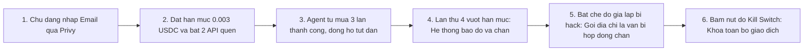
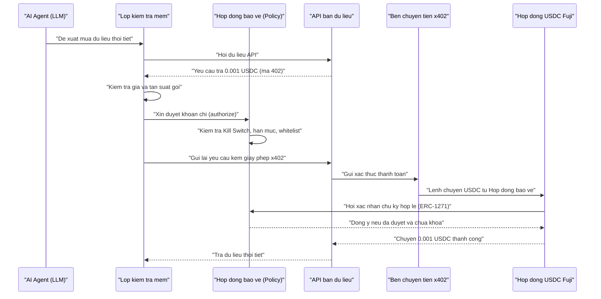

# Hướng dẫn chuẩn bị tài liệu & quyết định UI/UX trước khi đưa vào Figma (AgentLeash)

> **Dành cho:** Nguyên  
> **Mục tiêu:** Giúp Nguyên nắm nhanh tình trạng dự án hiện tại, chốt các quyết định về sản phẩm/giao diện (không cần đọc code), và từng bước đưa tài liệu vào **Figma** để thiết kế UI/UX cho **AgentLeash** (Avalanche Team1 Vietnam UniHack 2026).

---

## Mục lục
1. [Tình trạng code trên GitHub hiện tại (1 phút đọc)](#1-tình-trạng-code-trên-github-hiện-tại)
2. [7 việc Nguyên cần quyết định trước khi vẽ Figma](#2-7-việc-nguyên-cần-quyết-định-trước-khi-vẽ-figma)
3. [Các bước chuẩn bị & đưa tài liệu vào Figma](#3-các-bước-chuẩn-bị--đưa-tài-liệu-vào-figma)
4. [Tóm tắt 5 khu vực & 6 khung hình Demo cần thiết kế](#4-tóm-tắt-5-khu-vực--6-khung-hình-demo-cần-thiết-kế)
5. [Sơ đồ chuẩn bị sẵn để đưa vào FigJam](#5-sơ-đồ-chuẩn-bị-sẵn-để-đưa-vào-figjam)
6. [Checklist kiểm tra theo luật cuộc thi trước khi chốt Figma](#6-checklist-kiểm-tra-theo-luật-cuộc-thì-trước-khi-chốt-figma)

---

## 1. Tình trạng code trên GitHub hiện tại

- Repo GitHub `agentleash` hiện mới chỉ là **bộ khung trống** để khởi tạo dự án: phần giao diện web (`web/`) mới có 1 trang chữ đơn giản (`"Dashboard đang được xây dựng."`), chưa có màn hình hay nút bấm hoàn chỉnh.
- Vì vậy, **chưa thể lấy trực tiếp code trên GitHub nạp sang Figma** để ra giao diện được (nạp vào sẽ chỉ ra một trang trắng với 3 dòng chữ).
- **Cách làm đúng và nhanh nhất lúc này:**
  1. Nguyên chốt các quyết định về trải nghiệm người dùng ở **Mục 2** bên dưới.
  2. Đưa phần mô tả màn hình (Mục 4) và sơ đồ luồng (Mục 5) vào **Figma / FigJam** để thiết kế giao diện.
  3. Sau khi nhóm chốt bản thiết kế đẹp trên Figma, phần kỹ thuật sẽ dựa vào bản Figma đó để chuyển thành trang web thật trong thư mục `web/`.

*(Ghi chú: Trên máy làm việc của nhóm còn có một file `index.html` minh họa riêng nằm ngoài repo này — file đó chỉ là bản mô phỏng kịch bản để tham khảo màu sắc/hiệu ứng, không phải sản phẩm chính thức.)*

---

## 2. 7 việc Nguyên cần quyết định trước khi vẽ Figma

Những câu hỏi dưới đây quyết định trực tiếp **trên màn hình Figma có những nút gì, chia mấy trang, báo lỗi ra sao**. Nguyên chỉ cần chọn phương án (A/B) hoặc ghi ý kiến vào bảng này:

| # | Câu hỏi cần Nguyên quyết định | Giải thích dễ hiểu & Tác động tới Figma | Lựa chọn gợi ý |
|---|---|---|---|
| **1** | **Chọn "Danh sách cho phép cứng" hay "Hạn mức 2 tầng"?** | - **Cách A (Danh sách cứng - Whitelist):** Chỉ những địa chỉ API mà chủ đã bật "Cho phép" mới được trả tiền; địa chỉ lạ bị chặn ngay. - **Cách B (Hạn mức 2 tầng / Sandbox):** Địa chỉ quen được tiêu hạn mức lớn; địa chỉ lạ vẫn được phép thử với số tiền siêu nhỏ (ví dụ tối đa `0,001 USDC/lần`, `0,05 USDC/ngày`). *Ảnh hưởng:* Cách B cần vẽ thêm phần chỉnh 2 mức hạn mức trên giao diện. | **[ ] Chọn Cách A** *(đơn giản, dễ demo, khớp kịch bản gốc)* **[ ] Chọn Cách B** *(an toàn + linh hoạt hơn khi pitch)* |
| **2** | **Nút "Tạo Agent mới" & Công tắc "Giả lập bị hack" đặt ở đâu?** | Trong đặc tả có 2 nút phụ trợ cho video demo: 1. Nút **"Tạo ví Agent mới"** ngay trên web. 2. Công tắc **"Bỏ qua kiểm tra mềm"** (để giả lập agent bị chiếm quyền và chứng minh hợp đồng blockchain vẫn chặn được). *Ảnh hưởng:* Nếu hiện trên màn hình chính sẽ dễ bấm khi quay video 2 phút, nhưng cần bố trí gọn để không rối mắt. | **[ ] Hiện cả 2 trong thanh công cụ Demo trên màn hình chính** **[ ] Chỉ hiện ở trang Cài đặt / menu phụ** |
| **3** | **Bố cục 1 màn hình Dashboard tổng hợp hay chia nhiều trang?** | Có 5 phần cần hiển thị: *Tổng quan (đồng hồ xăng), Dòng tiền, Luật chi tiêu, Nút tắt khẩn cấp (Kill Switch), Lịch sử bị từ chối*. - **1 trang Dashboard (nhiều thẻ):** Khi quay video 2 phút, giám khảo nhìn thấy đồng hồ tụt dần và nút đỏ báo lỗi cùng lúc không phải chuyển tab. - **Nhiều trang có menu trái:** Gọn hơn nếu sau này mở rộng nhiều agent. | **[ ] 1 trang Dashboard tổng hợp (khuyến nghị cho Demo 2 phút)** **[ ] Chia menu nhiều trang riêng** |
| **4** | **Phong cách màu sắc (Dark hay Light) & Tên hiển thị** | - **Dark Mode (nền tối):** Mang cảm giác công nghệ/an ninh mạng, nổi bật các màu trạng thái (Xanh lá = An toàn, Xanh dương = Dòng tiền, Vàng = Cảnh báo, Đỏ = Kill Switch/Chặn). - **Light Mode (nền sáng):** Giống app tài chính/ngân hàng, dễ nhìn chữ khi chiếu màn hình phòng sáng. *Cần thêm:* Tên/biểu tượng **AgentLeash** (dây xích / khiên bảo vệ / đồng hồ). | **[ ] Dark Mode (nền tối)** **[ ] Light Mode (nền sáng)** *Ghi chú logo/icon mong muốn:* `...` |
| **5** | **Có vẽ "Sơ đồ dòng tiền nối dây" hay chỉ làm Bảng lịch sử?** | Mục *Dòng tiền* có 2 phần: 1. Hình minh họa dòng tiền chạy từ `Agent → các API bán dữ liệu` (đường nối dày/mỏng theo số tiền). 2. Bảng danh sách từng khoản đã chi kèm link kiểm tra trên Snowtrace. *Ảnh hưởng:* Sơ đồ nối dây giúp điểm UI/UX rất cao, nhưng nếu thiếu thời gian có thể ưu tiên làm Bảng lịch sử trước. | **[ ] Vẽ cả Sơ đồ nối dây + Bảng lịch sử** **[ ] Chỉ vẽ Bảng lịch sử cho gọn** |
| **6** | **Tài khoản & gói Figma dùng chung của nhóm** | - Cả đội sẽ lưu file thiết kế trên **tài khoản Figma của ai**? - Tài khoản đó đang dùng gói **Miễn phí (Starter)** hay **Education/Pro**? *(Gói miễn phí giới hạn tối đa 3 trang mỗi file Draft và không mở một số tính năng nâng cao như Figma Specs, nên cần biết trước để chia file cho hợp lý).* - Ai giữ quyền **Sửa (Can Edit)**, ai chỉ cần **Xem/Góp ý (Can View/Comment)**? | *Chủ file Figma:* `...` *Gói Figma:* `[ ] Free / [ ] Edu-Pro` *Danh sách email cần share:* `...` |
| **7** | **Xác nhận quy tắc chia sẻ tài liệu & đồng bộ GitHub** | - Quy tắc nội bộ (`AGENTS.md`) yêu cầu không gửi code/dữ liệu lên dịch vụ ngoài khi chưa thống nhất. Nguyên xác nhận **cho phép đưa bản mô tả giao diện & sơ đồ luồng** (không có mật khẩu hay key bí mật) lên Figma. - Lưu ý: một số tài liệu mới trên máy (lộ trình `ROADMAP.md` và phần chỉnh sửa mới của `SPEC.md`) chưa được đẩy lên nhánh `main` GitHub — cần bên kỹ thuật cập nhật lên `main` để link tài liệu gắn trong Figma luôn là bản mới nhất. | **[ ] Đồng ý đưa Spec UI & sơ đồ lên Figma** **[ ] Nhắc bên kỹ thuật đồng bộ bản `SPEC.md` / `ROADMAP.md` lên `main`** |

---

## 3. Các bước chuẩn bị & đưa tài liệu vào Figma

Sau khi Nguyên trả lời 7 mục ở trên, thực hiện theo đúng 4 bước dưới đây:

### Bước 1: Tạo không gian làm việc trên Figma (khoảng 5 phút)
1. Đăng nhập `figma.com`, tạo một Project/Thư mục tên **`AgentLeash - UniHack 2026`**.
2. Tạo **2 file tách biệt** để không bị rối:
   - **File 1 (Loại FigJam — Bảng trắng):** Đặt tên `AgentLeash - Luồng hoạt động & Kịch bản Demo`.
   - **File 2 (Loại Figma Design — Thiết kế giao diện):** Đặt tên `AgentLeash - Dashboard UI/UX`.
3. Chia sẻ link 2 file ở chế độ **Can Edit** cho thành viên cùng thiết kế/code.

### Bước 2: Đưa sơ đồ luồng vào File 1 (FigJam)
Nguyên không cần tự kéo từng ô vuông bằng tay:
- **Cách A (Nhanh nhất — nhờ AI có gắn plugin Figma):** Mở AI trợ lý đã cài plugin Figma, gửi link file FigJam vừa tạo kèm 7 quyết định ở Mục 2 và yêu cầu *"Vẽ 2 sơ đồ trong `docs/HUONG_DAN_CHUAN_BI_FIGMA.md` vào file FigJam này"*.
- **Cách B (Tự thao tác trong FigJam):** Mở file FigJam → bấm biểu tượng `+` / **More** → tìm **Mermaid** (hoặc dùng plugin Mermaid miễn phí trên Figma Community) → copy từng đoạn mã sơ đồ ở **Mục 5** bên dưới dán vào, FigJam sẽ tự dựng thành các khối hộp chỉnh sửa được.

### Bước 3: Tổ chức các trang (Pages) trong File 2 (Figma Design)
Nếu dùng gói Figma miễn phí (Starter) bị giới hạn 3 trang trong Draft, có thể gộp gọn thành **3 trang** như sau (còn gói Edu/Pro thì tách thoải mái):
1. **`01 - Brief & Tokens`:**
   - Dán tóm tắt 5 khu vực & bảng chữ hiển thị từ **Mục 4** vào một khung ghi chú ở bên trái.
   - Đặt bảng màu (An toàn, Cảnh báo, Khẩn cấp, Nền, Chữ) và mẫu chữ (tiêu đề, số tiền, địa chỉ ví).
   - Đặt kèm link GitHub của [`SPEC.md`](SPEC.md) để ai xem cũng tra cứu lại được.
2. **`02 - Wireframe & 6 Trang thai Demo`:**
   - Dựng khung xám (chưa cần đẹp) để chốt vị trí nút **Kill Switch**, **"Đồng hồ xăng"**, **Dòng tiền**, **Luật chi tiêu**, **Bị từ chối**.
   - Vẽ đủ **6 trạng thái nối tiếp nhau** theo đúng kịch bản video demo 2 phút (xem Mục 4.2) để kiểm tra xem mạch kể chuyện có mượt không.
3. **`03 - Hi-Fi UI & Prototype`:**
   - Lên màu hoàn chỉnh, nối mũi tên chuyển màn hình (Prototype) để bấm thử như app thật trước khi giao sang bên code.

*(Ghi chú thêm: Nếu muốn tham khảo giao diện mẫu từ file `index.html` có sẵn trên máy, hãy mở file đó bằng trình duyệt rồi chụp màn hình dán vào trang `01 - Brief & Tokens`, hoặc dùng plugin **html.to.design** trong Figma để tách thành các khung tham khảo — tránh dùng trực tiếp code từ repo GitHub vì hiện repo chưa có giao diện.)*

### Bước 4: Bàn giao lại cho bên kỹ thuật ghép vào Web
- Đặt tên các khung màn hình rõ ràng (ví dụ: `01-Login`, `02-Dashboard-Active`, `03-Blocked-OverCap`, `04-KillSwitch-Paused`).
- Gửi link Figma cho bên kỹ thuật (hoặc AI có Figma MCP) đọc trực tiếp kích thước, màu sắc và chuyển thành giao diện tĩnh trong thư mục `web/src/app/`, sau đó bên kỹ thuật sẽ nối dữ liệu thật từ blockchain vào.

---

## 4. Tóm tắt 5 khu vực & 6 khung hình Demo cần thiết kế

Đây là **danh sách đầy đủ** những gì phải có mặt trên giao diện (rút gọn bằng ngôn ngữ dễ hiểu từ [`SPEC.md`](SPEC.md)):

### 4.1. 5 khu vực chức năng của Dashboard
1. **Thanh trên cùng (Header & Đăng nhập Privy):**
   - Nút **Đăng nhập bằng Email** (giám khảo dùng ngay được, không cần cài ví).
   - Hiện địa chỉ ví hợp đồng đang bảo vệ tiền (`Policy Contract`), số dư **USDC test**, nhãn mạng **Avalanche Fuji**.
   - Nhãn khai báo rõ ràng theo Luật 6: **`Chế độ Demo: Chu kỳ hạn mức = 2 phút (Thực tế: 24 giờ)`**.
   - *(Nên có)* Nút **"Tạo Agent mới"**.
2. **Tổng quan ("Đồng hồ xăng" hạn mức):**
   - Thanh tiến độ / đồng hồ đo số tiền **đã dùng / tổng hạn mức chu kỳ** (ví dụ: `0.002 / 0.003 USDC`), kèm đồng hồ đếm ngược tới lúc hạn mức hồi lại.
   - Trạng thái hiện tại của Agent: **`Đang hoạt động`** (xanh) hoặc **`Đã khóa khẩn cấp`** (đỏ).
3. **Dòng tiền (Sơ đồ & Lịch sử giao dịch):**
   - Sơ đồ đơn giản: `AI Agent` → `Policy Contract` → các dịch vụ bán dữ liệu (`API Thời tiết`, `API Tỷ giá`).
   - Danh sách các lần Agent mua dữ liệu thành công, mỗi dòng cần hiện **3 bước trạng thái rõ ràng**: `Đang ký` → `Đang chờ` → `Xong`, kèm nút/link **`Xem trên Snowtrace`**.
4. **Luật chi tiêu (Guardrails):**
   - Ô chỉnh **Trần tối đa mỗi lần trả** và **Trần tối đa mỗi chu kỳ**.
   - Danh sách **Địa chỉ cho phép (Whitelist)** với công tắc Bật/Tắt nhanh cho các API quen thuộc và ô thêm địa chỉ mới.
   - *(Nên có cho Demo)* Công tắc **`Giả lập Agent bị chiếm quyền (Bỏ qua kiểm tra mềm)`** để diễn cảnh bước 5 trong video.
   - Ghi chú nhỏ cho người dùng biết: *Mỗi lần đổi luật cần xác nhận ký một giao dịch từ chủ ví.*
5. **Kill Switch & Nhật ký Bị từ chối:**
   - **Nút đỏ to, luôn hiển thị nổi bật:** **`KHÓA KHẨN CẤP (KILL SWITCH)`** — bấm vào là dừng ngay mọi giao dịch (kể cả giao dịch đã duyệt trước đó nhưng chưa chuyển tiền).
   - **Khu vực Bị từ chối:** Danh sách các lần hệ thống chặn Agent chi tiền, kèm lý do tiếng Việt dễ hiểu:
     - `"Vượt hạn mức chu kỳ"`
     - `"Vượt hạn mức mỗi lần"`
     - `"Người nhận không có trong whitelist"`
     - `"Hệ thống đang khóa khẩn cấp (Kill Switch)"`

### 4.2. 6 khung hình nối nhau cho kịch bản Video Demo 2 phút
Khi dựng Prototype trên Figma, hãy sắp xếp đúng 6 trạng thái sau để khớp kịch bản quay video:
1. **Khung 1 — Đăng nhập:** Chủ agent đăng nhập bằng Email qua Privy (không cần ví ngoài).
2. **Khung 2 — Thiết lập:** Đặt hạn mức `0.003 USDC / 2 phút`, bật 2 API (*Thời tiết*, *Tỷ giá*).
3. **Khung 3 — Agent mua 3 lần thành công:** Đồng hồ xăng tụt dần (`0.001` → `0.002` → `0.003 USDC`), 3 dòng lịch sử hiện đủ link Snowtrace.
4. **Khung 4 — Bị chặn lần 1 (vượt hạn mức):** Agent xin mua lần thứ 4 → Giao diện báo đỏ `"Vượt hạn mức chu kỳ"`, tiền không bị trừ.
5. **Khung 5 — Bị chặn lần 2 (giả lập bị chiếm quyền):** Bật công tắc `"Bỏ qua kiểm tra mềm"`, cho Agent gửi tiền tới địa chỉ lạ → Hợp đồng trên chuỗi vẫn chặn và hiện thông báo đỏ `"Người nhận không có trong whitelist"`.
6. **Khung 6 — Bấm Kill Switch:** Chủ bấm nút đỏ lớn → Trạng thái chuyển sang **`Đã khóa`**, mọi yêu cầu chi tiếp theo đều bị từ chối.

---

## 5. Sơ đồ chuẩn bị sẵn để đưa vào FigJam

Hai đoạn dưới đây đã được viết lại theo đúng định dạng chuẩn để đưa thẳng vào **FigJam** (tính năng Mermaid / công cụ `generate_diagram`) mà không bị lỗi hiển thị.

### Sơ đồ 1 — Hành trình 6 bước trong Kịch bản Demo (Dành cho thiết kế UI/UX)

### Sơ đồ 2 — Cách tiền đi qua "Dây xích" bảo vệ (Tóm tắt từ tài liệu kỹ thuật)

---

## 6. Checklist kiểm tra theo luật cuộc thi trước khi chốt Figma

Trước khi duyệt bản Figma để chuyển sang code, Nguyên rà soát nhanh 5 gạch đầu dòng bắt buộc của cuộc thi:

- [ ] **Không để AI tự quyết chuyển tiền (Luật 4):** Giao diện thể hiện rõ AI chỉ đề xuất, còn hạn mức, whitelist và Kill Switch mới là thứ quyết định cho chi.
- [ ] **Rõ yếu tố Avalanche:** Có hiển thị mạng Fuji, thanh toán x402 bằng USDC test, và link kiểm tra giao dịch trên Snowtrace.
- [ ] **Khai báo phần giả lập (Luật 6):** Có nhãn nhắc rõ *"Chu kỳ hạn mức 2 phút là cấu hình cho bản Demo"* ngay trên màn hình để khi quay video không quên nói.
- [ ] **Không đưa thông tin cá nhân lên chuỗi (Luật 5):** Phần lịch sử giao dịch trên blockchain chỉ ghi địa chỉ, số tiền và trạng thái — không ghi nội dung câu hỏi/truy vấn của người dùng lên chuỗi.
- [ ] **Phù hợp pháp lý Việt Nam (Luật 2 & 8):** Chỉ thể hiện thanh toán vi mô giữa máy-với-máy bằng USDC test để mua dữ liệu công khai (thời tiết, tỷ giá); không dùng từ ngữ trả lương, thu tiền thật hay tư vấn tài chính.
