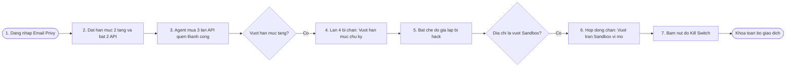
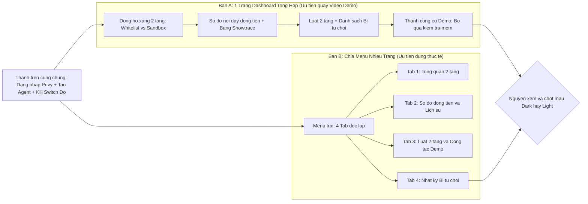
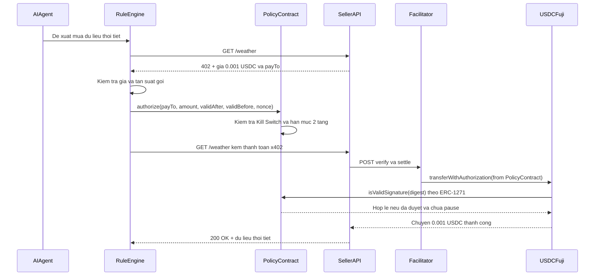

# Hướng dẫn chuẩn bị tài liệu & quyết định UI/UX trước khi đưa vào Figma (AgentLeash)

> **Dành cho:** Nguyên  
> **Cập nhật:** Đã chốt các phương án **1B**, **2 (gợi ý)**, **3 (2 bản so sánh)**, **5 (có sơ đồ dòng tiền)**, **6 (tài khoản Figma)**, **7 (đã đưa sơ đồ lên FigJam)** — chỉ còn **Mục 4 (màu Dark/Light & logo)** chờ Nguyên xem và chốt.  
> **Bảng FigJam đã tạo sẵn:** [AgentLeash — Luồng hoạt động & So sánh 2 bố cục UI](https://www.figma.com/board/lUMYemD6G4EiO4H3dcP7uj)

---

## Mục lục
1. [Tình trạng code trên GitHub & Bảng FigJam đã dựng](#1-tình-trạng-code-trên-github--bảng-figjam-đã-dựng)
2. [Bảng tổng hợp 7 quyết định (đã chốt & phần chờ Nguyên chốt)](#2-bảng-tổng-hợp-7-quyết-định)
3. [Các bước tiếp theo trên Figma](#3-các-bước-tiếp-theo-trên-figma)
4. [Tóm tắt 5 khu vực (đã cập nhật Hạn mức 2 tầng 1B) & 6 khung hình Demo](#4-tóm-tắt-5-khu-vực--6-khung-hình-demo)
5. [Sơ đồ Mermaid chuẩn (đã đẩy lên FigJam)](#5-sơ-đồ-mermaid-chuẩn-đã-đẩy-lên-figjam)
6. [Checklist kiểm tra theo luật cuộc thi trước khi chốt Figma](#6-checklist-kiểm-tra-theo-luật-cuộc-thì-trước-khi-chốt-figma)

---

## 1. Tình trạng code trên GitHub & Bảng FigJam đã dựng

- Repo GitHub `agentleash` hiện mới chỉ là **bộ khung trống** (`web/` mới có 1 trang chữ `"Dashboard đang được xây dựng."`), chưa có giao diện hoàn chỉnh để nạp trực tiếp từ code sang Figma.
- Nhóm đã chuyển sang quy trình **Thiết kế trước trên Figma → Xuất giao diện tĩnh sang `web/`**.
- **Đã đưa lên FigJam sẵn 3 sơ đồ** tại link: https://www.figma.com/board/lUMYemD6G4EiO4H3dcP7uj
  1. Kịch bản Demo 2 phút theo mô hình **Hạn mức 2 tầng (1B)**.
  2. So sánh trực quan **2 bố cục UI/UX (Bản A 1 trang vs Bản B nhiều trang)**.
  3. Luồng kỹ thuật thanh toán x402 qua Policy Contract (Sequence Diagram).
- Tài liệu chi tiết so sánh **Bản A vs Bản B** để Nguyên chọn giao diện xem tại: [FIGMA_UI_2_BAN_SO_SANH.md](FIGMA_UI_2_BAN_SO_SANH.md).

---

## 2. Bảng tổng hợp 7 quyết định

| # | Hạng mục | Trạng thái | Kết quả đã chốt / Gợi ý cho Nguyên |
|---|---|---|---|
| **1** | **Whitelist cứng hay Hạn mức 2 tầng?** | **Đã chốt: 1B (Hạn mức 2 tầng)** | Dùng mô hình **Tiered Sandbox**: - **Tầng 1 (Whitelist - Tin cậy):** Các API đã duyệt được chi với hạn mức lớn. - **Tầng 2 (Sandbox - API lạ):** API ngoài whitelist vẫn gọi được nhưng giới hạn siêu nhỏ (ví dụ tối đa `0.001 USDC/lần`, trần chu kỳ rất thấp) để vừa giữ tính mở của x402 vừa chống rút cạn ví. |
| **2** | **Vị trí nút "Tạo Agent mới" & Công tắc "Bỏ qua kiểm tra mềm"** | **Đề xuất chốt** | - **Nút `+ Tạo Agent mới`:** Đặt gọn ở **Thanh trên cùng (Header)** ngay cạnh tên/địa chỉ Agent đang chọn (không chiếm chỗ nội dung chính). - **Công tắc `Chế độ Demo: Bỏ qua kiểm tra mềm`:** Đặt trong **Thanh công cụ Demo nổi** (viền vàng cảnh báo, có thể thu gọn) trên màn hình chính để khi quay video 2 phút bấm chỉ 1 cú nhấp chuột, giám khảo nhìn thấy ngay là đang diễn cảnh giả lập bị hack. |
| **3** | **1 trang Dashboard tổng hợp hay chia nhiều trang?** | **Đã chốt: Làm cả 2 bản để so sánh** | Đã tách thành **Bản A (1 trang tổng hợp)** và **Bản B (Menu nhiều trang/tab)** trong [FIGMA_UI_2_BAN_SO_SANH.md](FIGMA_UI_2_BAN_SO_SANH.md) và trên [FigJam](https://www.figma.com/board/lUMYemD6G4EiO4H3dcP7uj) để nhóm & Nguyên đối chiếu trước khi lên màu chi tiết. |
| **4** | **Màu sắc (Dark hay Light) & Logo** | **CHỜ NGUYÊN XEM VÀ CHỐT** | Nguyên xem gợi ý so sánh ở [FIGMA_UI_2_BAN_SO_SANH.md](FIGMA_UI_2_BAN_SO_SANH.md#4-phần-chờ-nguyên-chốt-mục-4-màu-sắc--nhận-diện) rồi chọn: - `[ ] Dark Mode` (nền tối, nổi màu cảnh báo xanh/vàng/đỏ) - `[ ] Light Mode` (nền sáng, dễ đọc khi chiếu slide phòng sáng) - *Ý tưởng logo/tên hiển thị:* `...` |
| **5** | **Có vẽ Sơ đồ dòng tiền nối dây trực quan không?** | **Đã chốt: CÓ** | Vẽ cả **Sơ đồ dòng tiền nối dây** (`AI Agent → Policy Contract → API Thời tiết / Tỷ giá / API lạ Sandbox`, nét dày theo số tiền) lẫn **Bảng lịch sử giao dịch kèm link Snowtrace**. |
| **6** | **Tài khoản & gói Figma dùng chung** | **Đã kiểm tra thực tế** | Trên máy này đang đăng nhập tài khoản **`ZzIsS` (`tintin082006@gmail.com`)**, thuộc **`Bảo Nguyên Trương's team`** (gói **Starter miễn phí**, hiện ở trạng thái `seat: View`, đã tạo được bảng FigJam). - **Dùng tài khoản trên máy mỗi người được không?** **Được:** Ai vẽ ở máy nào cứ dùng tài khoản Figma đang đăng nhập trên máy đó để tạo file, rồi bấm **Share → `Can edit`** cho người còn lại. - **Lưu ý gói Starter (miễn phí):** Giới hạn tối đa 3 file Design / 3 trang mỗi file nháp; khi share trong Team Starter có thể cần kiểm tra quyền sửa giữa các thành viên (hoặc dùng Edu nếu có mail sinh viên để không bị giới hạn). |
| **7** | **Cho phép đưa tài liệu lên Figma & đồng bộ GitHub** | **Đã đồng ý** | Đã cho phép đưa bản mô tả giao diện & sơ đồ luồng (không chứa key/bí mật) lên Figma. Các file tài liệu kỹ thuật trên máy (`ROADMAP.md`, bản sửa `SPEC.md`) vẫn cần bên kỹ thuật cập nhật lên `main` để đồng bộ. |

---

## 3. Các bước tiếp theo trên Figma

1. **Bước 1 — Nguyên xem 2 sơ đồ & 2 bản bố cục:**
   - Mở bảng FigJam đã tạo sẵn: https://www.figma.com/board/lUMYemD6G4EiO4H3dcP7uj
   - Đọc bảng so sánh Bản A vs Bản B trong [FIGMA_UI_2_BAN_SO_SANH.md](FIGMA_UI_2_BAN_SO_SANH.md) và **chốt Mục 4 (chọn Dark hay Light Mode + logo)** và **chốt chọn Bản A hay Bản B** (hoặc giữ Bản A cho video demo).
2. **Bước 2 — Dựng file Figma Design (`AgentLeash - Dashboard UI/UX`):**
   - Tạo 1 file Figma Design trên tài khoản đang dùng, chia gọn **3 trang** (phù hợp cả gói Starter miễn phí):
     - `01 - Brief & Tokens`: Màu Dark/Light đã chốt, font `Geist` + `Geist Mono`, các badge trạng thái (`An toàn`, `Sandbox`, `Chờ duyệt`, `Bị chặn`).
     - `02 - Wireframe So Sanh`: Đặt **Bản A** và **Bản B** cạnh nhau ở dạng khung xám để thử cảm giác bấm.
     - `03 - Hi-Fi UI & 6 Demo States`: Lên màu hoàn thiện theo bản đã chọn với đủ 6 khung hình kịch bản demo 2 phút.
   - *(Ghi chú: Nếu muốn xem trước giao diện mẫu từ file `index.html` trên máy để tham khảo phong cách Dark Mode, có thể mở `index.html` bằng trình duyệt rồi chụp màn hình dán vào trang `01` hoặc dùng plugin `html.to.design`.)*
3. **Bước 3 — Bàn giao sang code (`web/`):**
   - Đặt tên các khung rõ ràng (`FuelGauge2Tier`, `CashflowDiagram`, `TransactionTable`, `TieredRulesPanel`, `KillSwitchButton`, `RejectedLogPanel`).
   - Share link file Figma Design cho bên kỹ thuật (hoặc AI có Figma MCP) đọc thiết kế và chuyển thành giao diện tĩnh trong `web/src/app/`.

---

## 4. Tóm tắt 5 khu vực & 6 khung hình Demo

### 4.1. 5 khu vực chức năng (đã cập nhật theo 1B + 2 + 5)

1. **Thanh trên cùng (Header, Đăng nhập Privy & Công cụ Demo):**
   - Nút **Đăng nhập bằng Email** (Privy — giám khảo không cần cài ví).
   - Bộ chọn Agent + nút phụ **`+ Tạo Agent mới`** (gợi ý mục 2).
   - Địa chỉ `Policy Contract`, số dư **USDC test**, nhãn mạng **Avalanche Fuji**.
   - Nhãn bắt buộc theo Luật 6: **`Chế độ Demo: Chu kỳ hạn mức = 2 phút (Thực tế: 24 giờ)`**.
   - **Thanh công cụ Demo (gợi ý mục 2):** Công tắc màu vàng **`Bỏ qua kiểm tra mềm (Giả lập bị hack)`**.
2. **Tổng quan ("Đồng hồ xăng" 2 tầng):**
   - **Đồng hồ Tầng 1 (Whitelist — Tin cậy):** Đã dùng / Tổng hạn mức chu kỳ (ví dụ `0.002 / 0.003 USDC`), kèm đồng hồ đếm ngược hồi hạn mức.
   - **Đồng hồ Tầng 2 (Sandbox — API ngoài whitelist):** Trần siêu nhỏ (ví dụ `0.000 / 0.001 USDC mỗi lần`, trần chu kỳ `0.002 USDC`) + số lần gọi còn lại.
   - Trạng thái tổng: **`Đang hoạt động`** (xanh) hoặc **`Đã khóa khẩn cấp`** (đỏ).
3. **Dòng tiền (Sơ đồ nối dây + Bảng lịch sử):**
   - **Sơ đồ nối dây trực quan (Mục 5):** `AI Agent` → `Policy Contract` → `API Thời tiết (Whitelist)` / `API Tỷ giá (Whitelist)` / `API lạ (Sandbox)` — độ dày dây tỷ lệ theo số tiền đã chi, màu dây phân biệt tầng Whitelist (xanh) và Sandbox (vàng), đường bị chặn hiện nét đứt đỏ.
   - **Bảng lịch sử giao dịch:** Mỗi dòng hiện rõ tầng (`Whitelist` / `Sandbox`), **3 trạng thái (`Đang ký` → `Đang chờ` → `Xong`)**, và nút **`Xem trên Snowtrace`**.
4. **Luật chi tiêu (Cấu hình 2 tầng):**
   - **Khối Whitelist (Tầng 1):** Bật/tắt các API quen, thêm địa chỉ mới, chỉnh hạn mức mỗi lần (`perTxCap`) và hạn mức chu kỳ (`dailyCap`).
   - **Khối Sandbox (Tầng 2):** Bật/tắt cho phép gọi API lạ ở chế độ vi mô, chỉnh trần Sandbox mỗi lần và trần Sandbox chu kỳ.
   - Ghi chú rõ: *Mỗi thay đổi luật là 1 giao dịch do chủ ví xác nhận ký.*
5. **Kill Switch & Nhật ký Bị từ chối:**
   - **Nút đỏ to, luôn hiển thị nổi bật:** **`KHÓA KHẨN CẤP (KILL SWITCH)`** — bấm vào là dừng ngay mọi giao dịch (chặn cả Tầng 1, Tầng 2 lẫn khoản đã duyệt nhưng chưa chuyển tiền).
   - **Danh sách Bị từ chối:** Gộp các lần bị chặn ở lớp kiểm tra mềm và hợp đồng on-chain, hiển thị lý do tiếng Việt:
     - `"Vượt hạn mức chu kỳ (Tầng Whitelist)"`
     - `"Vượt trần Sandbox cho API lạ"`
     - `"Hệ thống đang khóa khẩn cấp (Kill Switch)"`

### 4.2. 6 khung hình nối nhau cho Kịch bản Video Demo 2 phút (cập nhật 1B)
1. **Khung 1 — Đăng nhập:** Chủ agent đăng nhập bằng Email qua Privy.
2. **Khung 2 — Thiết lập 2 tầng:** Đặt hạn mức Whitelist `0.003 USDC / 2 phút`, bật 2 API (*Thời tiết*, *Tỷ giá*); đặt Sandbox API lạ tối đa `0.001 USDC / lần`.
3. **Khung 3 — Agent mua 3 lần thành công:** Đồng hồ tầng Whitelist tụt dần (`0.001` → `0.002` → `0.003 USDC`), sơ đồ nối dây sáng lên, 3 dòng lịch sử hiện link Snowtrace.
4. **Khung 4 — Bị chặn lần 1 (vượt hạn mức Whitelist):** Agent xin mua lần thứ 4 ở API quen → Báo đỏ `"Vượt hạn mức chu kỳ"`.
5. **Khung 5 — Bị chặn lần 2 (giả lập bị chiếm quyền qua Sandbox):** Bật công tắc `"Bỏ qua kiểm tra mềm"`, Agent thử gửi số tiền lớn tới địa chỉ lạ (hoặc vượt trần Sandbox) → Hợp đồng vẫn chặn và báo đỏ `"Vượt trần Sandbox cho API lạ"`.
6. **Khung 6 — Bấm Kill Switch:** Chủ bấm nút đỏ lớn → Trạng thái chuyển sang **`Đã khóa`**, toàn bộ yêu cầu chi tiếp theo (kể cả Whitelist hay Sandbox) đều bị chặn.

---

## 5. Sơ đồ Mermaid chuẩn (đã đẩy lên FigJam)

Các sơ đồ dưới đây đã được đẩy trực tiếp lên bảng FigJam tại https://www.figma.com/board/lUMYemD6G4EiO4H3dcP7uj:

### Sơ đồ 1 — Hành trình Kịch bản Demo & Hạn mức 2 tầng (1B)

### Sơ đồ 2 — So sánh 2 bố cục UI (Bản A vs Bản B)

### Sơ đồ 3 — Luồng thanh toán x402 qua Policy Contract 2 tầng

---

## 6. Checklist kiểm tra theo luật cuộc thi trước khi chốt Figma

- [ ] **Không để AI tự quyết chuyển tiền (Luật 4):** Giao diện thể hiện rõ AI chỉ đề xuất, còn hạn mức 2 tầng (Whitelist + Sandbox) và Kill Switch trên hợp đồng mới là lớp chặn quyết định.
- [ ] **Rõ yếu tố Avalanche:** Có hiển thị mạng Fuji, thanh toán x402 bằng USDC test, và link kiểm tra giao dịch trên Snowtrace.
- [ ] **Khai báo phần giả lập (Luật 6):** Có nhãn nhắc rõ *"Chu kỳ hạn mức 2 phút là cấu hình cho bản Demo"* ngay trên màn hình.
- [ ] **Không đưa thông tin cá nhân lên chuỗi (Luật 5):** Lịch sử trên blockchain chỉ ghi địa chỉ, số tiền và trạng thái — không ghi nội dung truy vấn của người dùng lên chuỗi.
- [ ] **Phù hợp pháp lý Việt Nam (Luật 2 & 8):** Chỉ dùng USDC test cho thanh toán máy-với-máy khi mua dữ liệu công khai (thời tiết, tỷ giá); không dùng từ ngữ trả lương, thu tiền thật hay tư vấn tài chính.
