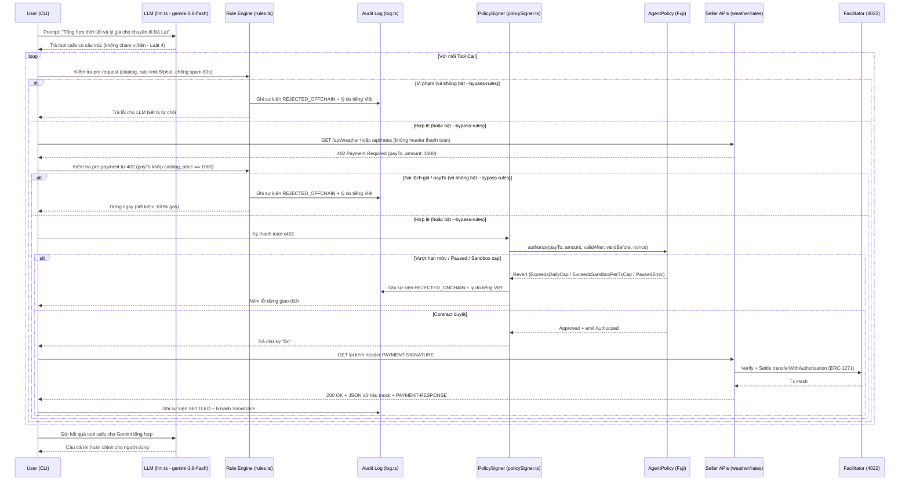

# Kế Hoạch & Quy Trình Thực Hiện Giai Đoạn 2: Agent (Gemini 3.8 Flash + Rule Engine + x402) & 2 API Sellers

> **Mục tiêu Giai đoạn 2 ([ROADMAP.md](ROADMAP.md)):** Xây dựng 2 API bán dữ liệu mock có cấu trúc qua giao thức x402 và Agent AI hoàn chỉnh (LLM tool calling + Rule Engine off-chain + PolicySigner tích hợp `AgentPolicy` on-chain).  
> **Tiêu chí hoàn thành ("Xong khi"):** Giao prompt *"Tổng hợp thời tiết và tỷ giá cho chuyến đi Đà Lạt"*, agent tự động gọi API mua dữ liệu 3 lần liên tiếp thành công (`200 OK`), và lần thứ 4 bị Policy Contract revert on-chain do vượt `dailyCap`.  
> **Người phụ trách:** Nguyên  
> **Cập nhật lần cuối:** 2026-11-13

---

## 0. Hiện trạng kiểm tra repo & chuẩn bị môi trường

### 0.1. Hiện trạng mã nguồn đã có (từ GĐ 0 & GĐ 1)
- **`sellers/`:**
  + `sellers/package.json`: Đã cài `@x402/core`, `@x402/evm`, `@x402/express`, `express`, `viem`.
  + `sellers/spike-server.mjs`: Server spike mẫu đang phục vụ `GET /api/weather` trên cổng `4021` với giá `0.001 USDC`.
- **`agent/`:**
  + `agent/package.json`: Đã cài `@x402/core`, `@x402/evm`, `@x402/fetch`, `viem`, `typescript`, `@types/node`, `tsx`. **Chưa cài** `@google/genai` và `vitest`.
  + `agent/tsconfig.json`: Đã cấu hình chuẩn ESM (`module: NodeNext`, `allowImportingTsExtensions: true`, `strict: true`).
  + `agent/src/policySigner.ts`: Đang dùng `createSpikePolicySigner` gọi `SpikePolicy.approve(digest)` — cần nâng cấp sang gọi `AgentPolicy.authorize(payTo, amount, validAfter, validBefore, nonce)`.
  + `agent/src/spikePay.ts`: Script test thanh toán đơn lẻ bằng CLI (giữ nguyên để tham chiếu/kiểm tra lẻ).
- **On-chain (`AgentPolicy` mẫu trên Fuji):**
  + `AgentPolicyFactory`: `0x369251fC256D8Ae3B25F66Fe1c4b3114A06BA864`
  + `AgentPolicy` mẫu: `0x7D49667A308161DD4810E6DDBEE5CBd67F4328AC` (số dư `0.01 USDC`, chu kỳ `period = 30s`).
  + **Phát hiện quan trọng từ `contracts/script/Deploy.s.sol`:**
    1. Mặc định khi deploy mới chỉ whitelist `WEATHER_PAY_TO` (`0x9D014376C3296db41770015AF074CF4D14c075E1`). **`RATES_PAY_TO` (`0x8D299966B407e9f189C1920f5A7324F13a9a4110`) chưa có trong whitelist.**
    2. Caps hiện tại trên contract là `perTxCap=10_000` (0.01 USDC), `dailyCap=30_000` (0.03 USDC), `sandboxPerTxCap=2_000` (0.002 USDC), `sandboxDailyCap=5_000` (0.005 USDC). Với mức `dailyCap=0.03 USDC`, agent sẽ mua được tận 30 lần thay vì bị chặn ở lần thứ 4. Cần cấu hình lại caps & whitelist bằng ví Owner trước khi nghiệm thu GĐ 2.

### 0.2. Checklist chuẩn bị môi trường (Bước 0)
- [x] **0.1.** Cài đặt dependencies bổ sung cho `agent/`:
  ```powershell
  cd agentleash/agent
  npm install @google/genai
  npm install -D vitest
  ```
- [x] **0.2.** Kiểm tra Facilitator tự host đang chạy ở `http://localhost:4022` (từ `../x402-pay-per-request/`) và ví facilitator có đủ AVAX Fuji trả gas (~0.10 AVAX).
- [x] **0.3.** Cập nhật cấu hình on-chain cho `AgentPolicy` mẫu (`0x7D49667A308161DD4810E6DDBEE5CBd67F4328AC`) từ ví Owner (`0xd30CcDd472372f92f9DeDFaafDeD9615136b75CB`):
  + Whitelist thêm `RATES_PAY_TO` (`0x8D299966B407e9f189C1920f5A7324F13a9a4110`): Tx `0xb9accca7ae8b3d9099801d424be38c105edfb351fbe324b1541c66374cd2bc4d`
  + Chỉnh caps theo kịch bản demo SPEC: `setCaps(2000, 3000, 500, 1000)` — Tx `0x9b404fe66a3b130246f58ba9aa9049ba818c7d19e6bd975e3051c9727558e24d` (tái kiểm on-chain PASS)

---

## 1. Kiến trúc tổng thể luồng thực thi GĐ 2



---

## 2. Chi tiết các đầu việc cần triển khai

### Việc 1: Dựng 2 API Sellers bán dữ liệu mock có cấu trúc (`sellers/`)

Tách và nâng cấp từ `sellers/spike-server.mjs` (giữ nguyên chú thích nguồn ở đầu file theo `SPEC.md`), gom phần boilerplate x402 chung vào `sellers/common.mjs`.

- [x] **1.1. Tạo `sellers/weather.mjs`:**
  + **Port:** `process.env.WEATHER_API_PORT || 4021`
  + **PayTo:** `process.env.WEATHER_PAY_TO || "0x9D014376C3296db41770015AF074CF4D14c075E1"`
  + **Giá:** `process.env.WEATHER_PRICE_USDC || "0.001"` (1,000 units)
  + **Endpoint `GET /api/weather?city=...&days=...`:**
    * Chưa trả tiền → `402 Payment Required` kèm `PAYMENT-REQUIRED` header.
    * Đã trả tiền → `200 OK` trả JSON dữ liệu mock có cấu trúc rõ ràng (hỗ trợ `Da Lat`, `Ha Noi`, `Ho Chi Minh`, fallback mặc định, dự báo 1–3 ngày, nhiệt độ, độ ẩm, khuyến nghị trang phục).
  + **Endpoint `GET /`:** Health check & thông tin bảng giá, địa chỉ `payTo`.

- [x] **1.2. Tạo `sellers/rates.mjs`:**
  + **Port:** `process.env.RATES_API_PORT || 4023`
  + **PayTo:** `process.env.RATES_PAY_TO || "0x8D299966B407e9f189C1920f5A7324F13a9a4110"`
  + **Giá:** `process.env.RATES_PRICE_USDC || "0.001"` (1,000 units)
  + **Endpoint `GET /api/rates?pair=...` (hỗ trợ thêm `?from=...&to=...`):**
    * Chưa trả tiền → `402 Payment Required` kèm `PAYMENT-REQUIRED` header.
    * Đã trả tiền → `200 OK` trả JSON dữ liệu tỷ giá mock có cấu trúc (`USD/VND`, `AVAX/USD`, `AVAX/VND`, `EUR/VND`, `JPY/VND`, `USDC/VND`).
  + **Endpoint `GET /`:** Health check & thông tin bảng giá, địa chỉ `payTo`.

- [x] **1.3. Cập nhật `sellers/package.json`:**
  + Thêm scripts `"start:weather"`, `"start:rates"`, `"start:spike"` (tái kiểm runtime HTTP 402 & health check bởi subagent PASS).

---

### Việc 2: Viết Rule Engine, Audit Logger và Unit Test (`agent/src/rules.ts`, `agent/src/log.ts`, `agent/test/rules.test.ts`)

- [x] **2.1. Xây dựng `agent/src/log.ts`:**
  + Định nghĩa kiểu dữ liệu `AuditLogEntry` (`ALLOWED`, `REJECTED_OFFCHAIN`, `REJECTED_ONCHAIN`, `SETTLED`) và các hàm `readAuditLogs`, `appendAuditLog`, `clearAuditLogs`.
  + Lưu ra file JSON `agent/logs/audit.json` (tự tạo thư mục nếu chưa có, hỗ trợ truyền đường dẫn riêng khi test).

- [x] **2.2. Xây dựng `agent/src/rules.ts`:**
  + Danh mục API đã đăng ký (`API_CATALOG`): `weather` (`WEATHER_PAY_TO`, `1000` units) và `rates` (`RATES_PAY_TO`, `1000` units).
  + Lớp `RuleEngine` hỗ trợ 2 bước kiểm tra `validatePreRequest` & `validatePaymentRequirements`, cùng `enforcePreRequest` & `enforcePaymentRequirements` tự động ghi log `REJECTED_OFFCHAIN` và ném `RuleViolationError`.
  + Đủ 5 mã lỗi (`UNREGISTERED_API`, `INVALID_PAY_TO`, `PRICE_MISMATCH`, `RATE_LIMIT_EXCEEDED`, `DUPLICATE_QUERY`) kèm lý do tiếng Việt rõ ràng; rate limit `5 lần/phút` mỗi API và chống spam `60s`.

- [x] **2.3. Viết Unit Test `agent/test/rules.test.ts` (Vitest):**
  + 7 test cases bao phủ đầy đủ ca đạt và ca bị chặn cho từng luật + kiểm tra ghi/đọc Audit Log JSON; `tsc --noEmit` (0 lỗi) và `vitest run` (`7 passed`) đều PASS sau tái kiểm độc lập.

---

### Việc 3: LLM Tool Calling với Gemini 3.8 Flash (`agent/src/llm.ts`)

- [x] **3.1. Xây dựng `agent/src/llm.ts` & `agent/test/llm.test.ts`:**
  + Sử dụng SDK chính thức `@google/genai` (`GoogleGenAI` + Interactions API) và model mặc định `gemini-3.8-flash`.
  + Tuân thủ **Luật 4 (Bắt buộc):** Không đọc private key, không import `viem` / `policySigner`, không biết địa chỉ ví hay số tiền USDC; chỉ sinh tool calls (`fetch_weather`, `fetch_exchange_rate`).
  + Hỗ trợ vòng lặp multi-turn (`runLlmAgentLoop`), giới hạn `maxTurns`, retry lỗi tạm thời (`503` / `429` ngắn), fail nhanh nếu hết quota ngày (`429 per day`), truyền `is_error: true` khi tool bị chặn.
  + Kiểm chứng: Smoke test gọi live `gemini-3.8-flash` với prompt *"Tổng hợp thời tiết và tỷ giá cho chuyến đi Đà Lạt"* sinh đủ 3 tool calls (`fetch_weather`, `fetch_exchange_rate USD/VND`, `fetch_exchange_rate AVAX/USD`) và tổng hợp tiếng Việt; `npm run typecheck` & `npm test` (11/11 tests passed, gồm 4 tests mới trong `test/llm.test.ts`) đều PASS.
  + *Ghi chú hạ tầng:* `GEMINI_API_KEY` Free Tier hiện tại đã chạm giới hạn 20 req/ngày trong lúc subagent test lặp lại nhiều lần — cần thay `GEMINI_API_KEY` mới (hoặc chờ reset quota) trước khi chạy nghiệm thu live E2E ở Bước 4.

---

### Việc 4: Nâng cấp `policySigner.ts` và Pipeline thực thi (`agent/src/run.ts`)

- [x] **4.1. Nâng cấp `agent/src/policySigner.ts` & `agent/test/policySigner.test.ts`:**
  + Thay thế bằng `agentPolicyAbi` đầy đủ (hỗ trợ `authorize`, `getRemainingCaps`, `paused`, custom errors) và `createAgentPolicySigner` gọi `AgentPolicy.authorize(payTo, amount, validAfter, validBefore, nonce)`.
  + Thêm `formatPolicyRevertReason` & `PolicyOnChainRejectedError` dịch custom errors sang tiếng Việt, `readPolicyStatus`, và callback `onAuthorized` / `onRejected` để tránh mất ngữ cảnh lỗi khi `@x402/fetch` wrap error.
  + Giữ tương thích `createSpikePolicySigner` cho `spikePay.ts` và bổ sung 5 unit tests trong `test/policySigner.test.ts`.

- [x] **4.2. Xây dựng `agent/src/run.ts` & cập nhật `agent/package.json`:**
  + Nối trọn pipeline: `LLM -> RuleEngine (pre-request & onBeforePaymentCreation) -> AgentPolicy.authorize -> @x402/fetch -> Sellers -> Audit Log (SETTLED / REJECTED_OFFCHAIN / REJECTED_ONCHAIN)`.
  + Hỗ trợ `--prompt`, `--bypass-rules`, `--rogue-pay-to <address>`, và `--replay-plan`; có `unwrapKnownError` 3 tầng khôi phục lỗi gốc kể cả khi `@x402/fetch` không giữ `err.cause`.
  + Cập nhật scripts `run:agent`, `demo:gd2`, `demo:bypass` trong `agent/package.json`.

---

## 3. Kế hoạch kiểm chứng & Nghiệm thu Giai đoạn 2

- [x] **Kiểm chứng 1 (Static & Unit Test):**
  + `npm run typecheck` (`tsc --noEmit`) → **PASS** (0 lỗi).
  + `npm test` (`vitest run`) → **PASS** (**3/3 files, 16/16 tests passed**: `rules.test.ts` 7, `llm.test.ts` 4, `policySigner.test.ts` 5).

- [x] **Kiểm chứng 2 (Sellers & 402 Gate):**
  + Facilitator (`4022`), `WeatherSeller` (`4021`), `RatesSeller` (`4023`) đều hoạt động ổn định và trả `402` chuẩn x402 v2 (`amount: "1000"`).

- [x] **Kiểm chứng 3 (Tiêu chí hoàn thành GĐ 2 — 3 lần thành công + lần 4 revert `ExceedsDailyCap`):**
  + ✅ **ĐẠT ngày 13/11** với policy demo mới `0x2acc0af39b9892529c052d7192ac03664f079671` (chu kỳ 120s, caps 2000/3000/500/1000), chạy `npm run demo:mock`: weather, rates, rates trả 200 OK (settle tx `0x82f53bef…1584`, `0x9faa6501…f713`, `0x45930adf…3c13`); lần 4 bị `AgentPolicy` revert `ExceedsDailyCap` (0.004 > 0.003 USDC). Số dư policy 0.01 → 0.007 USDC.
  + *Đã kiểm chứng qua `--replay-plan` trên Fuji:* Cả `Weather` và `Rates` settle thật thành công (4 tx hashes ghi vào `agent/logs/audit.json`, số dư Policy giảm từ `0.01` xuống `0.006 USDC`).
  + *2 blocker phát hiện khi tái kiểm:*
    1. **Thời gian chu kỳ `30s` vs tốc độ testnet Fuji:** Tổng thời gian chạy tuần tự 4 giao dịch x402 trên Fuji mất ~40s (`t=0s, +13s, +28s, +40s`), nên giao dịch thứ 4 rơi sang chu kỳ `30s` mới và tự rollover thay vì revert `ExceedsDailyCap`. Cần anh Nguyên chốt phương án xử lý (deploy policy demo `period=120s` hoặc tối ưu gửi `authorize` song song với nonce queue).
    2. **Quota `GEMINI_API_KEY`:** Key Free Tier trong `.env` đang báo `429 Rate limit exceeded (limit: 20 requests per day)`. Cần thay key mới để chạy nghiệm thu `npm run demo:gd2` trực tiếp qua Gemini.

- [x] **Kiểm chứng 4 (Mô phỏng Agent bị chiếm mã — `--bypass-rules`):**
  + Chạy `npm run demo:bypass` (`--bypass-rules --rogue-pay-to 0x1111111111111111111111111111111111111111`) → **PASS**: Rule Engine bị bỏ qua, `AgentPolicy.authorize` trên Fuji revert `ExceedsSandboxPerTxCap`, và `agent/logs/audit.json` ghi đúng bản ghi `REJECTED_ONCHAIN` với lý do tiếng Việt.

- [ ] **Kiểm chứng 5 (Cập nhật tiến độ & Nhật ký phiên):**
  + Đánh dấu `[x]` hoàn thành GĐ 2 trong `docs/ROADMAP.md`.
  + Ghi nhật ký phiên vào `docs/sessions/`.
