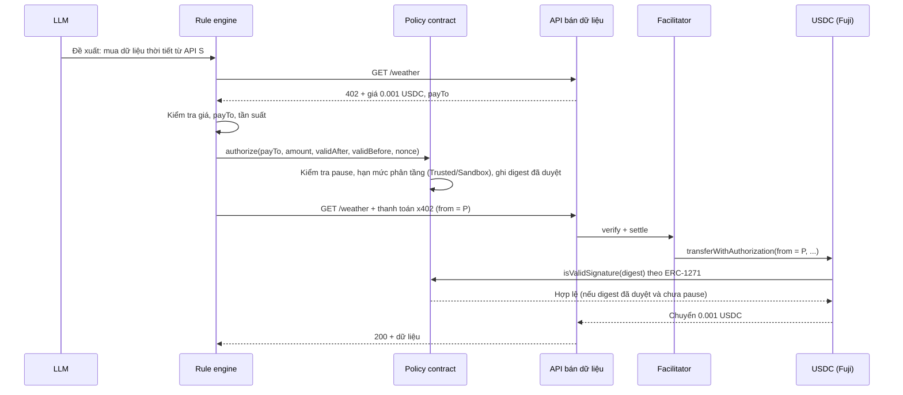

# Đặc tả MVP: AgentLeash

Nguồn quyết định (nằm ngoài repo, trên máy Nguyên): `UniHack_avalanche/reports/2026-11-08-y-tuong-1-agentleash.md`, nhất là mục "Thiết kế đã sửa sau phản biện", và `UniHack_avalanche/reports/2026-11-09-bao-cao-phan-tich-2-starter-kit-btc.md`. File này tóm đủ để làm việc. Thấy chỗ nào lệch với báo cáo thì báo Nguyên.

## Một câu

AI agent tự trả tiền API qua x402, nhưng tiền nằm trong một policy contract của chủ agent. Agent chỉ được *xin* chi, contract mới *quyết* chi theo hạn mức, whitelist và nút tắt khẩn cấp. Chủ agent xem dòng tiền theo thời gian thực.

- **Track:** AI Agents / x402 (ghép đề 12 và đề 17).
- **Mạng:** Avalanche Fuji C-Chain (chainId 43113), USDC test. Không cần L1.
- **Hạn nộp:** 23:59 ngày 21/11/2026.

## Phạm vi

| Mức | Gồm |
|---|---|
| **Bắt buộc** | Policy contract (kèm `release(nonce)`) và test, deploy và verify trên Fuji; vòng x402 qua ERC-1271 chạy thật; agent có rule engine (`gemini-3.8-flash` qua `@google/genai`); dashboard có đồng hồ hạn mức, danh sách khoản chi, kill switch; 2 API bán dữ liệu mock có cấu trúc (Thời tiết & Tỷ giá) |
| **Nên có** | Factory "tạo agent" ngay trên giao diện; sơ đồ dòng tiền; chế độ demo "bỏ qua rule engine" |
| **Bonus nếu dư giờ** | Danh tính agent theo ERC-8004 (khoảng 3–5 giờ); bản thứ hai chạy trên L1 riêng (chỉ khi có VPS chạy node đến 30/11) |

Ước tính 65–85 giờ code, trên quỹ chung khoảng 90–100 giờ.

## Lịch (đề xuất, Nguyên chưa chốt)

Bản chi tiết từng giai đoạn, kèm mốc "xong khi" và thứ tự cắt khi trễ: [ROADMAP.md](ROADMAP.md).

| Ngày | Việc | Mốc kiểm tra |
|---|---|---|
| 09–10/11 | Chạy thử trọn vòng: contract duyệt, facilitator nhận, API trả 200 | **Tối 10/11 quyết** facilitator (xem mục "Chưa chốt") |
| 11–13/11 | Policy contract hoàn chỉnh, test và fuzz, deploy và verify Fuji | `forge test` xanh trên CI |
| 13–15/11 | Agent: LLM tool calling, rule engine, x402 client; dựng 2 API bán | Agent tự mua 3 lần không cần can thiệp |
| 15–18/11 | Dashboard: Privy, event theo thời gian thực, kill switch, màn bị từ chối | Chạy trọn kịch bản demo |
| 18–19/11 | Factory, chế độ demo, ERC-8004 nếu kịp | — |
| 19–21/11 | README, sơ đồ kiến trúc, script nạp dữ liệu mẫu, quay video, dự phòng | Nộp trước hạn ít nhất nửa ngày |

## Vai

| Vai | Là ai | Làm gì |
|---|---|---|
| **Chủ agent** | Dev hoặc doanh nghiệp chạy agent | Nạp USDC vào contract, đặt hạn mức và whitelist, bấm kill switch, rút tiền |
| **Agent** | Chương trình LLM có tool calling | Tự mua dữ liệu trong phạm vi được phép. Ví của agent chỉ gọi được `authorize` và chỉ giữ ít AVAX trả gas |
| **Bên bán API** | API thu phí qua x402 | Nhận USDC ngay khi giao dữ liệu |
| **Bên kiểm tra** | Kế toán, kiểm toán, giám khảo | Đọc luật chi tiêu và lịch sử chi trên Snowtrace |

## Kiến trúc

| Thư mục | Nội dung |
|---|---|
| `contracts/` | `AgentPolicy` (mỗi chủ agent một contract) và factory tạo contract |
| `agent/` | LLM (`gemini-3.8-flash` qua `@google/genai`), rule engine và x402 client (TypeScript) |
| `sellers/` | 2 API bán dữ liệu mock có cấu trúc thu phí qua x402 (Thời tiết & Tỷ giá) |
| `web/` | Dashboard Next.js: đăng nhập Privy (`@privy-io/react-auth`) + `viem` thuần (không dùng `wagmi`), đồng hồ hạn mức, dòng tiền, kill switch |

Starter kit của ban tổ chức (`x402-pay-per-request`, `privy-agent-wallet`) **không nằm trong repo**. Cần code mẫu thì chỉ chép đúng phần dùng tới vào thư mục tương ứng, và ghi nguồn ở đầu file.

## Luồng một khoản chi



1. **LLM đề xuất**, ví dụ "mua dữ liệu thời tiết Đà Lạt". LLM không có khóa, không thấy số tiền, không gọi contract.
2. **Rule engine gọi API** và nhận mã 402 kèm giá và `payTo`.
3. **Rule engine kiểm tra ngoài chuỗi:** giá khớp bảng giá, `payTo` đúng của API đó, tần suất gọi trong giới hạn. Sai thì dừng, không tốn gas.
4. **Rule engine gọi `authorize`** trên policy contract bằng ví agent.
5. **Contract kiểm tra trên chuỗi:** chưa pause; nếu `payTo` trong whitelist thì áp hạn mức Trusted (`perTxCap`, `dailyCap`), nếu ngoài whitelist thì áp hạn mức Sandbox thấp hơn (`sandboxPerTxCap`, `sandboxDailyCap`), và chi tiêu Sandbox vẫn tính chung vào `dailyCap` (`spentInPeriod`). Đạt thì contract tự tính digest EIP-712, ghi là đã duyệt và trừ hạn mức.
6. **Agent gửi lại yêu cầu** kèm thanh toán x402, người trả (`from`) là địa chỉ policy contract.
7. **Facilitator gọi USDC.** USDC thấy người trả là contract nên hỏi `isValidSignature`, và contract chỉ chấp nhận đúng digest đã duyệt.
8. **USDC chuyển tiền** sang bên bán, API trả dữ liệu, dashboard hiện khoản chi kèm link Snowtrace.

Agent bị chiếm và bỏ qua rule engine thì vẫn phải qua bước 5. Đây là lớp chặn cuối.

**Vì sao USDC phải nằm trong contract:** x402 kiểu "exact" dùng chữ ký EIP-3009, facilitator gọi thẳng vào USDC. Nếu USDC nằm trong ví EOA của agent thì khoản chi đi vòng qua policy contract và vi phạm luật 4. Vì vậy contract tự giữ USDC và đứng làm người trả theo ERC-1271.

## Policy contract

Khung giao diện (chưa phải code cuối):

```solidity
contract AgentPolicy {
    address public owner;          // chủ agent: EOA hoặc Safe
    address public agent;          // ví agent, chỉ được gọi authorize
    IFiatToken public immutable usdc;

    // Hạn mức phân tầng (6 số thập phân)
    uint256 public perTxCap;           // trần mỗi khoản cho địa chỉ Trusted (whitelist)
    uint256 public dailyCap;           // tổng trần mỗi chu kỳ (gồm cả Trusted và Sandbox)
    uint256 public sandboxPerTxCap;    // trần mỗi khoản cho địa chỉ ngoài whitelist
    uint256 public sandboxDailyCap;    // trần mỗi chu kỳ riêng cho ngoài whitelist
    uint256 public period;             // cấu hình qua constructor: 1 days khi chạy thật; 120s (DEMO_PERIOD_SECONDS=120) khi demo
    uint256 public spentInPeriod;
    uint256 public sandboxSpentInPeriod;
    uint256 public periodStart;

    mapping(address => bool) public whitelist;
    mapping(bytes32 => uint256) public approvedUntil;  // digest => validBefore
    bool public paused;

    // validAfter bắt buộc: digest TransferWithAuthorization của EIP-3009 có trường này
    function authorize(address payTo, uint256 amount, uint256 validAfter, uint256 validBefore, bytes32 nonce)
        external onlyAgent whenNotPaused returns (bytes32 digest);
    function isValidSignature(bytes32 hash, bytes calldata) external view returns (bytes4);
    function release(bytes32 nonce) external;           // hoàn hạn mức nếu validBefore đã qua và nonce chưa dùng trên USDC

    // Chỉ chủ agent
    function pause() external;
    function unpause() external;
    function setWhitelist(address payTo, bool allowed) external;
    function setCaps(uint256 perTx, uint256 daily, uint256 sandboxPerTx, uint256 sandboxDaily) external;
    function withdraw(uint256 amount) external;   // rút USDC về ví chủ
}
```

Sáu quyết định thiết kế:

1. **Contract tự tính digest** từ tham số khoản chi, bằng `DOMAIN_SEPARATOR` và typehash `TransferWithAuthorization` của USDC. Không nhận digest do agent đưa vào, vì agent có thể xin duyệt một digest trả cho địa chỉ vượt hạn mức hoặc sai tham số.
2. **Trừ hạn mức ngay khi duyệt**, không chờ tiền chuyển xong. Hàm `release(nonce)` (làm ở GĐ 1): khi `validBefore` đã qua mà USDC báo nonce chưa dùng (`authorizationState`), hoàn lại hạn mức (và hoàn phần sandbox nếu khoản đó là sandbox).
3. **Kill switch chặn cả khoản đã duyệt.** Khi `paused = true`, `isValidSignature` trả thất bại, nên khoản đã duyệt mà facilitator chưa gửi lên chuỗi cũng bị chặn.
4. **Mỗi chủ agent một contract**, tạo qua factory. Chỉ chủ rút được tiền, không có quỹ chung (luật 3).
5. **Chu kỳ hạn mức cấu hình qua constructor:** `1 days` khi chạy thật, `120s` (`DEMO_PERIOD_SECONDS=120`; 30s quá ngắn so với tốc độ Fuji) khi demo. Đây là giả lập thời gian nên phải khai đầu pitch (luật 6).
6. **Chính sách chi tiêu phân tầng (Trusted vs Sandbox):** Địa chỉ trong whitelist dùng `perTxCap` và `dailyCap`; địa chỉ ngoài whitelist dùng ngưỡng Sandbox thấp hơn là `sandboxPerTxCap` và `sandboxDailyCap`, và mọi khoản chi Sandbox vẫn tính chung vào `dailyCap` (`spentInPeriod`).

**Test Foundry bắt buộc** (ban tổ chức ghi "tests are mandatory on the money paths"):

- Vượt `perTxCap`, vượt `dailyCap` (với whitelist), vượt `sandboxPerTxCap` hoặc `sandboxDailyCap` hoặc tổng `dailyCap` (với ngoài whitelist): `authorize` revert.
- Gọi `authorize` từ ví không phải agent: revert.
- Sau `pause()`: `authorize` revert, và `isValidSignature` từ chối cả digest đã duyệt trước đó.
- Digest hết hạn (`validBefore` đã qua): bị từ chối.
- Hạn mức hồi lại khi sang chu kỳ mới (`vm.warp`, cả `spentInPeriod` và `sandboxSpentInPeriod`).
- `release(nonce)` hoàn hạn mức khi `validBefore` đã qua và nonce chưa dùng trên USDC; revert nếu chưa hết hạn hoặc nonce đã dùng.
- Fuzz: với mọi chuỗi `authorize` ngẫu nhiên, tổng đã duyệt trong một chu kỳ không vượt `dailyCap` và phần ngoài whitelist không vượt `sandboxDailyCap`.
- Test tích hợp trên fork Fuji: gọi `transferWithAuthorization` thật của USDC với `from` là policy contract.

## Rule engine

LLM dùng **Gemini `gemini-3.8-flash`** (`@google/genai`), chỉ trả về đề xuất có cấu trúc, ví dụ `{ "tool": "buy_data", "api": "weather", "query": "Da Lat" }`. Hai API bán dữ liệu **mock có cấu trúc** gồm Thời tiết (`weather`) và Tỷ giá (`rates`). Rule engine (TypeScript, viết tay, có test) quyết có chi hay không:

- Chỉ gọi API trong danh mục đã đăng ký, mỗi API gắn một `payTo` cố định.
- Giá trong phản hồi 402 phải khớp bảng giá, lệch là dừng.
- Giới hạn tần suất, ví dụ tối đa 5 lần mỗi phút cho mỗi API.
- Không mua lại cùng một truy vấn trong khoảng thời gian ngắn.

Rule engine chặn sớm và rẻ. Policy contract là lớp cuối, không ai vượt được, kể cả khi rule engine bị chiếm.

## Dashboard

| Màn hình | Nội dung |
|---|---|
| **Tổng quan** | "Đồng hồ xăng" hạn mức còn lại trong chu kỳ, số dư USDC của contract, trạng thái agent (đang chạy hoặc đã khóa) |
| **Dòng tiền** | Sơ đồ agent → các API, mỗi đường dày theo số tiền. Danh sách khoản chi theo event của contract, mỗi dòng có link Snowtrace |
| **Luật chi tiêu** | Sửa hạn mức, thêm hoặc bớt whitelist. Mỗi thay đổi là một giao dịch do chủ ký |
| **Kill switch** | Nút đỏ, to, luôn hiện. Bấm là gọi `pause()` |
| **Bị từ chối** | Các lần rule engine hoặc contract chặn, kèm lý do tiếng Việt ("vượt hạn mức ngày", "vượt trần Sandbox") |

Đăng nhập email qua **Privy (`@privy-io/react-auth`) + `viem` thuần (bỏ `wagmi`)**, giám khảo không cần cài ví. Mỗi giao dịch có 3 trạng thái rõ: đang ký, đang chờ, xong (kèm link Snowtrace).

## Kịch bản demo khoảng 2 phút

1. **Mở đầu (luật 6):** "Trong demo, chu kỳ hạn mức đặt 120 giây (`DEMO_PERIOD_SECONDS=120`) thay vì 1 ngày."
2. **Thiết lập:** chủ đăng nhập email, tạo agent với hạn mức Trusted (ví dụ 0.003 USDC mỗi chu kỳ) và ngưỡng Sandbox thấp hơn (ví dụ 0.0005 USDC mỗi lần / 0.001 USDC mỗi chu kỳ), whitelist hai API dữ liệu mock (Thời tiết & Tỷ giá).
3. **Agent làm việc:** nhiệm vụ "tổng hợp thời tiết và tỷ giá cho chuyến đi Đà Lạt". Agent mua dữ liệu 3 lần, đồng hồ hạ dần, mỗi khoản có link Snowtrace.
4. **Bị chặn lần 1:** lần mua thứ 4 vượt hạn mức, contract revert, dashboard báo đỏ.
5. **Bị chặn lần 2 (agent bị chiếm):** bật chế độ "bỏ qua rule engine", cho agent gọi thẳng contract để trả cho địa chỉ lạ (ngoài whitelist) với mức giá thông thường (ví dụ 0.001 USDC). Contract vẫn từ chối vì **vượt trần Sandbox**.
6. **Kill switch:** chủ bấm nút đỏ, mọi khoản chi tiếp theo bị chặn, kể cả khoản đã duyệt trước đó.
7. **Kết:** mở Snowtrace, contract đã verify và lịch sử chi khớp dashboard.

## Địa chỉ và tham số đã biết

| Mục | Giá trị |
|---|---|
| Fuji C-Chain | chainId 43113, RPC `https://api.avax-test.network/ext/bc/C/rpc` |
| USDC Fuji (`FiatTokenV2_2`, hỗ trợ ERC-1271) | `0x5425890298aed601595a70AB815c96711a31Bc65` |
| AgentPolicyFactory (Fuji) | [`0x369251fC256D8Ae3B25F66Fe1c4b3114A06BA864`](https://testnet.snowscan.xyz/address/0x369251fc256d8ae3b25f66fe1c4b3114a06ba864) |
| AgentPolicy demo (Fuji, chu kỳ 120s, từ 14/11; chủ là ví Privy của Nguyên `0x80a8dd777A3Ba8e13F5A933911b76CBb6451d58A`, tạo từ web) | [`0x62Ea5e422b3ef66174B6Dd6Aa855F1f036894177`](https://testnet.snowscan.xyz/address/0x62ea5e422b3ef66174b6dd6aa855f1f036894177) |
| AgentPolicy demo 13/11 (chủ là ví deploy, chỉ còn giữ lịch sử) | [`0x2acc0af39b9892529c052d7192ac03664f079671`](https://testnet.snowscan.xyz/address/0x2acc0af39b9892529c052d7192ac03664f079671) |
| Routescan API (lịch sử event, không cần key) | `https://api.routescan.io/v2/network/testnet/evm/43113/etherscan/api`. RPC công khai Fuji chỉ cho `eth_getLogs` 100 block/lần |
| AgentPolicy mẫu cũ (Fuji, chu kỳ 30s, không dùng cho demo) | [`0x7D49667A308161DD4810E6DDBEE5CBd67F4328AC`](https://testnet.snowscan.xyz/address/0x7d49667a308161dd4810e6ddbee5cbd67f4328ac) |
| ERC-8004 Identity Registry trên Fuji | `0x8004A818BFB912233c491871b3d84c89A494BD9e` |
| Facilitator tương thích | Facilitator tự host (`http://localhost:4022`, mặc định); PayAI công khai (`https://facilitator.payai.network`, dự phòng) |

## Chưa chốt

1. **Facilitator có nhận chữ ký ERC-1271 không.** **ĐÃ CHỐT (chi tiết tại [SPIKE.md](SPIKE.md)):** Đã kiểm chứng thành công trên Fuji với `SpikePolicy` (`0x38706AFC0f92b6908389ebF377aab688a2BDe951`). Chốt dùng **Facilitator tự host** (`FACILITATOR_URL=http://localhost:4022`) làm mặc định khi demo (ổn định, chủ động gas, không phụ thuộc downtime bên ngoài) và **PayAI** (`https://facilitator.payai.network`) làm facilitator công khai dự phòng. Không dùng Ultravioleta DAO do từ chối ERC-1271 với lỗi `invalid_signature`.
2. **Whitelist cứng hay hạn mức phân tầng.** **ĐÃ CHỐT:** Dùng **hạn mức phân tầng** (Trusted/Whitelist dùng `perTxCap` và `dailyCap`; ngoài whitelist dùng ngưỡng Sandbox thấp hơn là `sandboxPerTxCap` và `sandboxDailyCap`, vẫn tính chung vào `dailyCap`). Bước 5 demo: khoản trả cho địa chỉ lạ bị chặn vì vượt trần Sandbox.
3. **Thư viện web.** **ĐÃ CHỐT:** Dùng **Privy (`@privy-io/react-auth`) + `viem` thuần, bỏ `wagmi`** (giống starter kit `privy-agent-wallet`).
4. **Câu hỏi giám khảo về Safe:** **ĐÃ KIỂM CHỨNG:** `AllowanceModule` chuẩn của Safe (`safe-global/safe-modules`) chỉ cấu hình `struct Allowance(amount, spent, resetTimeMin, lastResetMin, nonce)` theo cặp `(safe, delegate, token)` để gọi `executeAllowanceTransfer(safe, token, to, ...)`:
   - Không có **whitelist người nhận** hay phân tầng `Trusted` vs `Sandbox` tích hợp sẵn — một khi delegate được cấp allowance, delegate có thể gửi tối đa phần còn lại tới bất kỳ địa chỉ `to` nào (trừ khi tự viết wrapper/guard ngoài).
   - Không cấp **chữ ký ERC-1271 theo từng khoản chi** cho giao thức `x402`: `AllowanceModule` chuyển token trực tiếp qua `execTransactionFromModule`, còn `CompatibilityFallbackHandler.isValidSignature` của Safe kiểm tra chữ ký owner/hash đã duyệt sẵn chứ không kiểm tra allowance của delegate. Ngược lại, `AgentPolicy.sol` gắn trực tiếp `authorize(payTo, amount, validAfter, validBefore, nonce)` (băm EIP-712 cho Circle USDC `transferWithAuthorization`) vào `isValidSignature`, khóa trần mỗi giao dịch + chu kỳ + Sandbox + `pause()` ngay cả cho khoản đã authorize nhưng chưa settle.

## Luật cuộc thi cần nhớ khi code và pitch

- **Luật 3:** non-custodial, không gom quỹ. Mỗi chủ một contract, chỉ chủ rút.
- **Luật 4:** LLM không bao giờ là bên quyết chuyển tiền; agent phải có policy contract với hạn mức, whitelist, kill switch.
- **Luật 5:** trên chuỗi chỉ có địa chỉ, số tiền và trạng thái. Nội dung truy vấn của agent không lên chuỗi.
- **Luật 6:** dữ liệu hay thời gian giả lập (chu kỳ `120s` theo `DEMO_PERIOD_SECONDS=120`, dữ liệu Thời tiết & Tỷ giá mock) phải khai ngay đầu pitch.
- **Luật 2 và 8:** crypto không phải phương tiện thanh toán ở Việt Nam. Chỉ dùng USDC test cho dịch vụ máy với máy, không trả lương, không thu tiền thật của người dùng, không tư vấn tài chính.
- **Luật 9**, ba câu phải trả lời được:
  - *Vì sao on-chain:* luật chi tiêu phải nằm ở nơi agent không sửa được và mọi bên kiểm tra được.
  - *Vì sao Avalanche:* có facilitator x402 chạy sẵn trên Fuji và C-Chain, USDC Fuji hỗ trợ ERC-1271, phí đủ thấp để khoản 0.001 USDC có ý nghĩa. Nói thật là x402 cũng có trên chuỗi khác.
  - *Tiền đến từ đâu:* phí SaaS theo số agent được quản lý, hoặc phí nhỏ trên mỗi giao dịch x402 đi qua policy.

---

## Định hướng phát triển tiếp theo (Thuần x402 MCP Gateway — Mô hình Bên A – Bên B)

Sau khi hoàn thiện MVP bảo vệ chi tiêu x402 trên Avalanche Fuji, sản phẩm phát triển tập trung **thuần theo chuẩn HTTP `x402` (USDC on-chain)** để làm cổng kiểm thử & quản lý ngân sách cho AI agents và công cụ lập trình tự động:

- **Vai trò hai bên:**
  - **Bên A (AI Agents / Coding Tools):** Antigravity, Claude Code, Cursor, hoặc agent tự động dùng MCP.
  - **Bên B (AgentLeash):** Đóng vai cổng kiểm thử & bảo vệ chi tiêu x402 (MCP Gateway + Rule Engine + `AgentPolicy` + Dashboard) cắm vào Bên A.
- **Luồng nghiệp vụ chính:**
  1. **Tự động test API x402 lạ (Sandbox):** Khi Bên A cần thử một endpoint x402 mới, Bên B áp dụng 4 lớp kiểm tra: (a) giới hạn ngân sách Sandbox siêu nhỏ trên `AgentPolicy`, (b) kiểm tra an toàn URL chống giả mạo và SSRF, (c) chặn vòng lặp / giới hạn tần suất (rate limit), (d) đánh giá chất lượng dữ liệu trả về.
  2. **Sử dụng API x402 quen (Whitelist / Trusted):** Các địa chỉ `payTo` đã tin cậy được gọi với hạn mức cao hơn qua cấu hình ổn định.
  3. **Chuyển "Lạ → Quen" 1-click:** Trên Dashboard của Bên B, chủ ví xem lại các giao dịch x402 mà Bên A đã thử (kèm chi phí và trạng thái) rồi bấm chọn **Chuyển thành API quen** (`setWhitelist`).
- **Định vị thị trường & phạm vi (chốt 18/11/2026):**
  - **Tập trung 100% vào x402:** Mọi thanh toán đều đi qua HTTP `402` + EIP-3009 USDC + `AgentPolicy` trên Avalanche, giúp kiến trúc đồng nhất và giữ sắc nét lý do bắt buộc dùng smart contract on-chain. Đối tượng dùng đầu tiên là **dev / AI agent builders** và các agent trong hệ sinh thái x402/MCP.
  - **Tầm nhìn dài hạn (tùy chọn ngoài phạm vi hiện tại):** Nếu về sau mở rộng sang tệp người dùng non-tech phổ thông khi hệ sinh thái x402 chưa phủ đủ API thường ngày, mới cân nhắc bổ sung thêm lớp Vault giữ API Key truyền thống ở tầng Gateway.
- **Nguyên tắc với bản nộp 21/11 (Mức dễ — chạy local không cần sửa tay `.json`):** Không thay đổi hoặc làm mất ổn định Smart Contract (`AgentPolicy.sol`) và luồng demo 7 bước đã nghiệm thu. Trong phạm vi nộp trước 21/11 gồm: cầu nối MCP local (`agent/src/mcp.ts` cho luồng x402 trên Fuji), trả kèm `DASHBOARD_URL` trong `hint` để chủ ví mở Dashboard ký thêm/xóa/sửa bằng Privy (✅ xong 18/11, PR #12, đã thử thật với bản Vercel), ô **Thêm API quen bằng địa chỉ (`payTo`)** + tùy chọn đồng bộ mục *Bị từ chối* qua Upstash Redis cho bản Vercel (✅ xong 19/11, PR #14; chưa bật biến Upstash thì đọc `agent/logs/audit.json` local như cũ), và **1 lệnh setup** `npm --prefix agent run setup:mcp` cho Claude Code & Antigravity (`mcp.ts` tự nạp `.env` repo và lọc bỏ khóa owner/facilitator, ✅ xong 19/11, PR #15). Gói plugin và `Streamable HTTP` thuộc phần Remote MCP sau 21/11 bên dưới.

### Lộ trình nâng cấp `agent/src/mcp.ts` thành Remote MCP Gateway x402 thực thụ (Mức phức tạp — sau 21/11)

Bản `agent/src/mcp.ts` hiện tại đã chạy chuẩn MCP cho luồng thanh toán x402 trên Fuji (`test_unknown_api`, `call_trusted_api`, `get_policy_status`). Phần phức tạp để nâng cấp thành **Remote MCP đa người dùng** (kiểu Canva / Notion / Figma, không cần Node hay `.env` trên máy người dùng) và dùng trong production được tách sang giai đoạn sau 21/11:

1. **Hỗ trợ đầy đủ phương thức HTTP (`POST`, `PUT`, `DELETE`), headers & JSON body:** Mở rộng `executePaidRequest` (hiện chỉ gọi `GET`) để gọi được các API x402 thực tế cần truyền payload hoặc header tùy biến.
2. **Siết bảo vệ SSRF mức production:** Tách cấu hình dev/demo khỏi production để chặn triệt để `localhost`, `127.0.0.1`, các dải IP nội bộ (`10.0.0.0/8`, `172.16.0.0/12`, `192.168.0.0/16`, `::1`) và DNS rebinding (hiện mới chặn cloud metadata hosts để giữ khả năng gọi seller local khi demo).
3. **Sổ đăng ký `URL/domain ↔ payTo` & Lớp đánh giá chất lượng output (Lớp 4):** Ánh xạ tên API quen sang URL/địa chỉ nhận tiền tương ứng (thay vì chỉ whitelist theo `payTo` on-chain) và kiểm tra schema/độ khớp mục tiêu người dùng trước khi trả dữ liệu cho Bên A.
4. **Remote MCP đa người dùng (`Streamable HTTP` + OAuth Privy + DB dùng chung + Session Key + Plugin Marketplace):** Chuyển từ tiến trình local (đòi Node ≥ 22, `AGENT_PRIVATE_KEY` trong `.env` và `agent/logs/audit.json` local; hiện bản demo mới có bước đệm đồng bộ tùy chọn mục *Bị từ chối* sang Vercel qua Upstash Redis ở PR #14) sang server Remote MCP chạy 24/7 trên cloud: xác thực OAuth/token gắn với `policyAddress` của từng chủ ví Privy, quản lý ví Agent/Session Key riêng cho từng user, nối database đa người dùng với Dashboard Vercel và đóng gói phát hành Plugin lên Marketplace của IDE.
5. *(Tùy chọn dài hạn nếu mở rộng sang non-tech đại chúng)* **Vault giữ API Key truyền thống:** Bổ sung proxy giữ `Bearer` / `x-api-key` cho API Web2 thông thường, không làm ảnh hưởng lõi on-chain x402.
